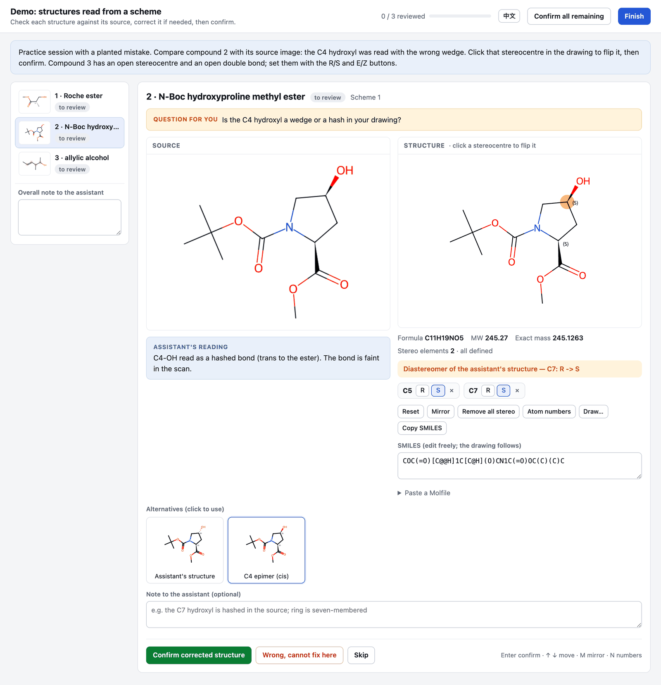
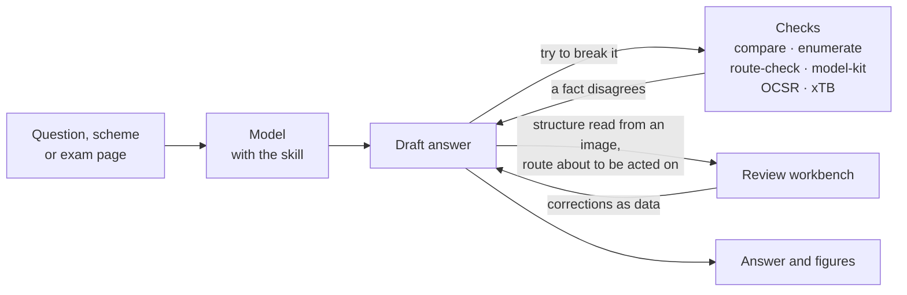
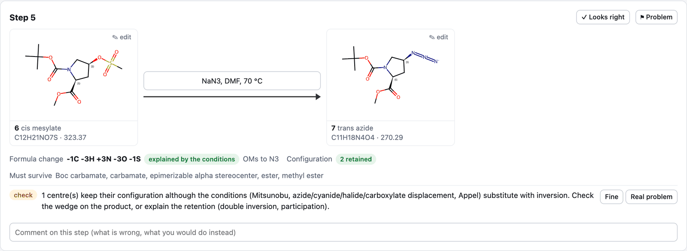
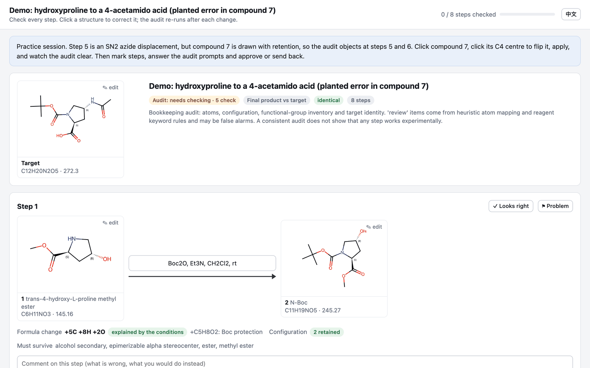
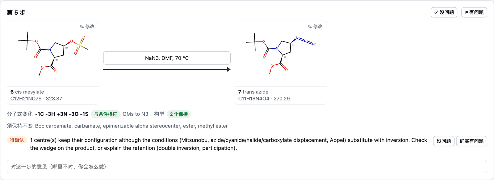
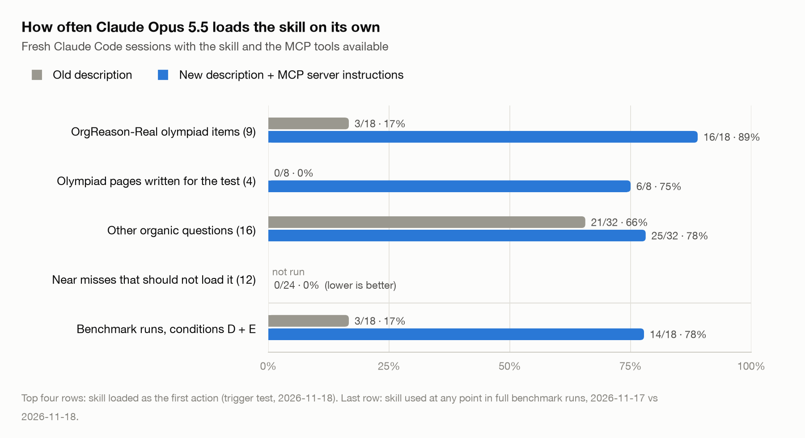

# Codex Organic Chemistry Assistant

**English** · [中文](README.zh-CN.md)

A local toolchain that lets an AI assistant check organic chemistry at the
level of structures. The model reasons first. Then it tries to break its own
answer with checks whose result differs between a right and a wrong structure,
route or count. Structures read from images and routes about to be acted on go
to a chemist on a review page. The final structures can be drawn as route and
mechanism figures.

It ships as a Python package (CLI, MCP server and kit), a skill for Claude Code
and Codex, and a browser review workbench.

<p align="center">
  
  <br>
  <sub>The review workbench. The C4 hydroxyl was misread as a hash; one click on the centre fixed it, and the page states how the edit relates to the original. <a href="docs/images/review-structures.zh.png">中文界面</a></sub>
</p>

> This is a research assistant, not a safety authority. Treat synthetic,
> mechanistic and computational suggestions as hypotheses that need literature
> review and expert validation.

**Contents:**
[What is in the box](#what-is-in-the-box) ·
[How the pieces work together](#how-the-pieces-work-together) ·
[Features](#features) ·
[Benchmarks](#benchmarks) ·
[Quick start](#quick-start) ·
[Claude Code and Codex](#using-it-from-claude-code-or-codex) ·
[Documentation](#documentation) ·
[Repository layout](#repository-layout) ·
[License](#license)

## What is in the box

| Part | What it is | Where |
|---|---|---|
| Toolchain | A Python package built on RDKit: the `codex-chem` CLI, the `codex-chem-mcp` MCP server (26 tools) and `codex_organic_chem.kit` for free-form Python. Optional engines: GFN2-xTB, CREST, Open Babel and several OCSR models. | `src/codex_organic_chem` |
| Skill | `organic-chemistry-assistant`: a reason, try-to-break-it, fix loop with a table of which check refutes which claim. Task protocols (routes, reaction outcomes, structure input, figures, kit API) are loaded on demand. A `chem-route-critic` subagent gives a route an independent second reading. | `.claude/skills`, `.agents/skills`, `.claude/agents` |
| Review workbench | A browser page where a chemist confirms or corrects structures and routes, in English or Chinese. It needs no build step, and the corrections come back as data. | `src/codex_organic_chem/review_ui` |

## How the pieces work together



The skill tells the model which check can refute which kind of claim and how to
read each result. The MCP server also tells the client, on connection, to load
the skill before the first tool call.

## Features

### Checks that can fail

Parsing a SMILES the model has just written cannot fail in an informative way.
These checks can:

| CLI / MCP tool | What it answers |
|---|---|
| `compare` / `chem_compare_structures` | Same compound, enantiomer, diastereomer or constitutional isomer, and which centres differ. |
| `enumerate` / `chem_enumerate` | How many stereoisomers or substitution products, and how many symmetry-distinct C and H environments (NMR signal counts). |
| `route-check` / `chem_route_check` | Per step: whether a reagent named in the conditions accounts for the formula change; whether each stereocentre was retained, inverted, destroyed or created, judged by spatial arrangement under an atom mapping rather than by CIP letters; which groups drawn unchanged the reagent class attacks (33 classes); which atoms cannot be traced. Per route: the last product against the target, centre by centre. |
| `model-kit` / `chem_model_kit` | 3D questions from conformer ensembles: which face is shielded and by which atoms, whether two atoms can approach, anti-periplanar populations, planarity, whether a ring fusion can exist, which isomer is lower in energy (optionally refined with GFN2-xTB). |

```bash
uv run codex-chem compare --a "C[C@H](O)CC" --b "C[C@@H](O)CC"        # enantiomers
uv run codex-chem enumerate --smiles "CC1CCCCC1" --task substitution   # 5 constitutional, 12 with stereo
uv run codex-chem enumerate --smiles "OCC(O)CO" --task environments    # 2 C and 5 H environments
uv run codex-chem route-check --example > route.json
uv run codex-chem route-check --route route.json --issues-only
```

`blocking` issues are facts; `review` items are heuristic prompts. See
[docs/verification-kit.md](docs/verification-kit.md) and the
[kit API reference](.agents/skills/organic-chemistry-assistant/references/kit-api.md).

### Structures from images

`parse-image` runs the configured OCSR engines over several preprocessed
variants of a crop. MolScribe is the default; DECIMER, MolGrapher, OpenChemIE,
OSRA and ChemSchematicResolver are optional. Every candidate is kept with its
warnings, and readings that no second engine corroborates are flagged.
`parse-scheme` adds R-group definitions and warns about likely recognition jumps
along a route. On a hard nine-crop test scheme none of the open-source engines
produced an exact match. That is why, by default, every structure read from an
image goes to the review workbench before anything is built on it.

### Review workbench

**Structures.** Each structure is shown next to the image it was read from,
with the assistant's reading, its question and any alternative readings. The
reviewer clicks a stereocentre to flip it, sets open centres and double bonds
with R/S and E/Z buttons, edits SMILES, pastes a Molfile or draws in Ketcher.
The page states at once how the edit relates to the original (see the image at
the top).

**Routes.** `route-review` lays out the `route-check` audit step by step, with
changed centres highlighted on each product. Editing a structure or the
conditions re-runs the audit at once. Each step can be marked right or wrong,
each audit prompt answered, and the route approved or sent back.

<p align="center">
  
  <br>
  <sub>Step 5 of the practice route: an SN2 azide displacement drawn with retention, which the audit flags.</sub>
</p>

<details>
<summary>More screenshots, English and 中文</summary>

| English | 中文 |
|---|---|
| [](docs/images/review-route.en.png) | [](docs/images/review-route.zh.png) |
| [](docs/images/review-route-step.en.png) | [](docs/images/review-route-step.zh.png) |
| [](docs/images/review-route-editor.en.png) | [](docs/images/review-route-editor.zh.png) |
| [](docs/images/review-structures.en.png) | [](docs/images/review-structures.zh.png) |

</details>

Review sessions outlive the command that opens them: a small background server
keeps the page up and saves every change under `~/.codex-chem/reviews/`.
`review-mode auto|ask|off` decides whether the assistant opens the page at a
review gate, asks first, or stays silent. `codex-chem review-demo` opens two
practice sessions with planted mistakes (`--lang zh` for Chinese). More in
[docs/human-review.md](docs/human-review.md).

### Figures

`route-figure` composes a route from reviewed structures into one SVG master and
a PNG. `mechanism-render` draws an atom-mapped mechanism (MechanismSpec 2.1)
with curved electron arrows. It first validates the mechanism: atoms, hydrogens
and charges are conserved; electron moves are replayed against the next state.
It exports SVG, CDXML, ChemDoodle, Ketcher and Marvin files, and it refuses to
publish a figure with an arrow that has no electron source or sink.

<p align="center">
  
  <br>
  <sub>Cyanohydrin formation, one of the curated mechanism test cases. The route figure example is in <a href="docs/figures.md">docs/figures.md</a>.</sub>
</p>

### Computation and literature

- RDKit: normalization, descriptors, conformers, charges, drawing.
- GFN2-xTB: optimized geometries and energies, Fukui indices and charges,
  frequencies and free-energy corrections. CREST: conformer ensembles with
  populations. Both are used when installed; `codex-chem doctor` says what is
  missing.
- `literature-search`: OpenAlex abstracts, citation counts and open-access
  links, with Crossref as fallback. `synthesis-suggest` is for interactive,
  one-disconnection-at-a-time brainstorming.

## Benchmarks

Three questions, each measured on its own. The numbers come from our own runs;
the benchmark harness, the problems and the run records are not part of this
repository.

### Does the model load the skill?

A skill that is never loaded cannot help. In the OrgReason-Real run of
2026-11-17, Claude Opus 5.5 loaded the skill in 3 of 18 runs. After the skill
description was rewritten and the MCP server got instructions, it loaded the
skill in 14 of 18.

<picture>
  <source media="(prefers-color-scheme: dark)" srcset="docs/images/skill-loading.en.dark.png">
  
</picture>

| Sessions (Opus 5.5, xhigh) | Old description | New description + MCP server instructions |
|---|---|---|
| OrgReason-Real olympiad items (9), loaded first | 3/18 | 16/18 (25/27 with and without the instructions) |
| Olympiad pages written for the test (4), loaded first | 0/8 | 6/8 |
| Other organic questions (16), loaded first | 21/32 | 25/32 |
| Near misses that should not load it (12) | not run | 0/24 |
| Benchmark runs, conditions D + E, used at all | 3/18 | 14/18 |

The model still answers some questions on the spot without the skill (an
isomer count, a chair conformation, the haloform reaction).

### Does route-check notice a planted error?

Three curated eight-step routes were corrupted one compound at a time: an
inverted centre, a dropped wedge, an E/Z flip, a lost carbon, an extra CH₂, an
O/N swap, a shifted substituent, an omitted last step.

<picture>
  <source media="(prefers-color-scheme: dark)" srcset="docs/images/route-audit.en.dark.png">
  
</picture>

| | Earlier checks (balance, normalization) | route-check, blocking or review |
|---|---|---|
| Planted errors that change the output | 67/282 (24%) | 280/282 (99%) |
| False alarms on the 24 correct steps | all 24 called unbalanced | no blocking issue; 0-3 review prompts per route |

This measures whether the feedback discriminates, not whether a model acts on
it. Reproduce with `uv run python scripts/benchmark_route_check.py --output-dir outputs/route_check_benchmark`.

### Does it help on real olympiad problems?

OrgReason-Real uses nine organic problems from IChO 2026 and CChO 2026, sent as
page images and graded field by field against hand-transcribed answers.
Condition A has no tools. D adds the MCP tools and the skill. E adds an opt-in
Python tool on top of D.

<picture>
  <source media="(prefers-color-scheme: dark)" srcset="docs/images/orgreason-real.en.dark.png">
  
</picture>

| Condition (Opus 5.5, xhigh) | Mean auto score | Skill used | Cost per run |
|---|---|---|---|
| A, no tools (2026-11-17) | 0.878 | – | 0.96 USD |
| D, MCP tools + skill (2026-11-18) | 0.906 | 7/9 | 1.41 USD |
| E, D + Python tool (2026-11-18) | 0.978 | 7/9 | 1.08 USD |

Read these numbers as preliminary:

- Each problem ran once per condition. Condition A alone scored 0.923 in an
  earlier run, so a single run varies by about 0.05.
- Five of the nine problems got full marks in every condition. Most of E's lead
  comes from one problem (CCHO40-P4: A 0.20, D 0.40, E 1.00).
- The gold answers are hand-transcribed and have not yet been signed off by a
  chemist.
- The CChO problems are copyrighted by the Chinese Chemical Society and are
  used for internal evaluation only.

Repeated runs are needed before claiming an accuracy gain.

## Quick start

The simplest way is to open the repository in Claude Code or Codex and ask it to
install the project. [INSTALL.md](INSTALL.md) is written for that (`CLAUDE.md`
and `AGENTS.md` point the agent to it): the agent installs the environment,
checks it and connects the MCP server.

By hand, with [uv](https://docs.astral.sh/uv/), which provides Python 3.12 and
installs every dependency at the version pinned in `uv.lock`:

```bash
uv sync --locked --extra mcp
uv run python scripts/check_install.py    # the last line must be "install OK"
uv run codex-chem compare --a "C[C@H](O)CC" --b "C[C@@H](O)CC"
uv run codex-chem review-demo             # two practice review pages; --lang zh for Chinese
```

Optional engines (xTB, CREST, Open Babel, OCSR models, Ketcher) and
troubleshooting are in [INSTALL.md](INSTALL.md).

## Using it from Claude Code or Codex

- **Claude Code:** open this repository as the working directory and approve
  the MCP server when asked. The skill in
  `.claude/skills/organic-chemistry-assistant` and the server in `.mcp.json`
  are picked up automatically.
- **Codex:** the skill lives in `.agents/skills/organic-chemistry-assistant`;
  the MCP server entry for `~/.codex/config.toml` is in
  [INSTALL.md](INSTALL.md#4-connect-the-mcp-server-and-the-skill).

Keep one copy of the skill per host. An older copy installed under the same
name (in user skills or a synced account) is listed next to this one, and the
model may load either. Hosts without a shell can enable the `chem_python` MCP
tool with `CODEX_CHEM_ENABLE_PYTHON=1`. Details:
[docs/skills-and-mcp.md](docs/skills-and-mcp.md).

## Documentation

| Topic | Where |
|---|---|
| Verification kit, route checking, synthesis suggestions | [docs/verification-kit.md](docs/verification-kit.md) |
| Skills, MCP server, tool list | [docs/skills-and-mcp.md](docs/skills-and-mcp.md) |
| Review workbench | [docs/human-review.md](docs/human-review.md) |
| Mechanism and route figures, editor integrations | [docs/figures.md](docs/figures.md) |
| Optional engines (xTB, CREST, OCSR, ChemDraw, Ketcher ...) | [docs/external-tools.md](docs/external-tools.md) |
| Kit API and the skill's task protocols | [.agents/skills/organic-chemistry-assistant/references](.agents/skills/organic-chemistry-assistant/references) |
| Dependencies and licensing | [DEPENDENCIES.md](DEPENDENCIES.md), [THIRD_PARTY_NOTICES.md](THIRD_PARTY_NOTICES.md) |
| Changes | [CHANGELOG.md](CHANGELOG.md) |

## Repository layout

```text
src/codex_organic_chem/      CLI, MCP server, kit, review workbench (review_ui/)
.claude/skills/              the skill for Claude Code
.claude/agents/              chem-route-critic subagent
.agents/skills/              the same skill for Codex
integrations/ketcher/        optional Ketcher editor for the review page
integrations/chemdoodle/     optional ChemDoodle Web Components viewer
scripts/                     installers, tool benchmarks, OCSR adapters, README figures
docs/                        detailed documentation and images
tests/                       pytest suite
```

## License

MIT, see [LICENSE](LICENSE). The optional ChemDoodle Web Components files are
third-party GPLv3/commercial files; see
[THIRD_PARTY_NOTICES.md](THIRD_PARTY_NOTICES.md). The charts in this README are
drawn by `scripts/make_readme_figures.py`.
