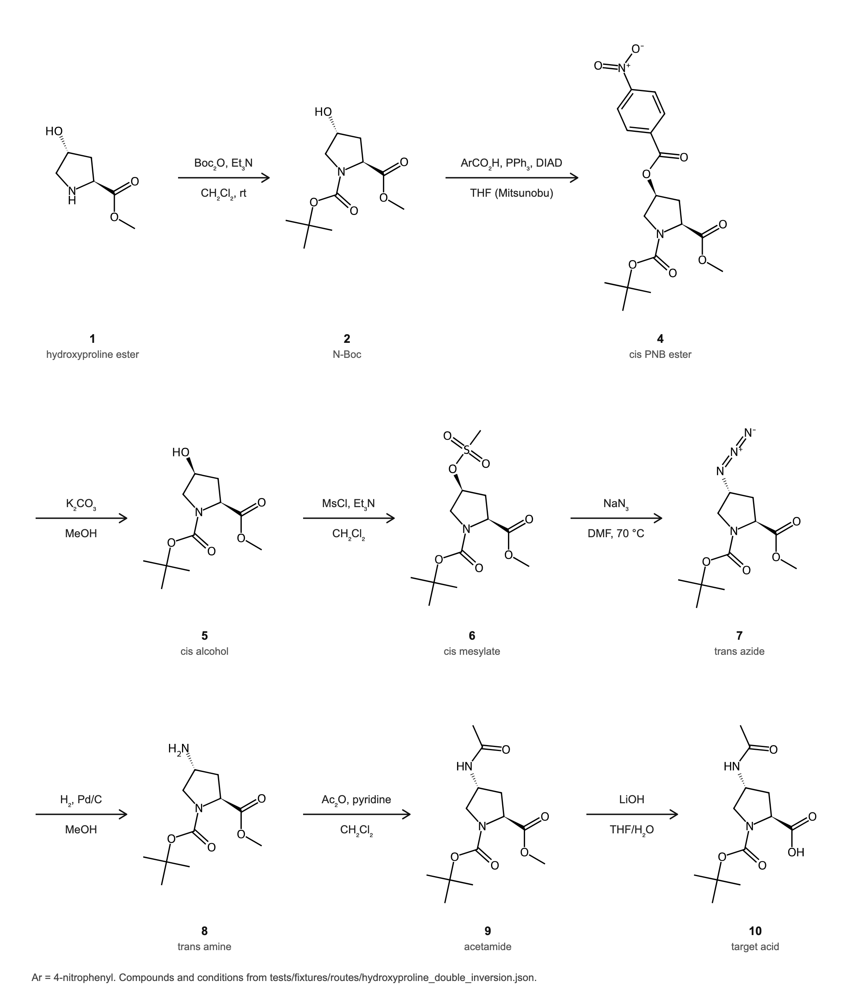
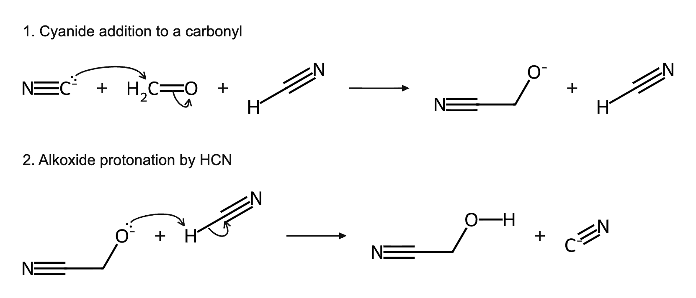
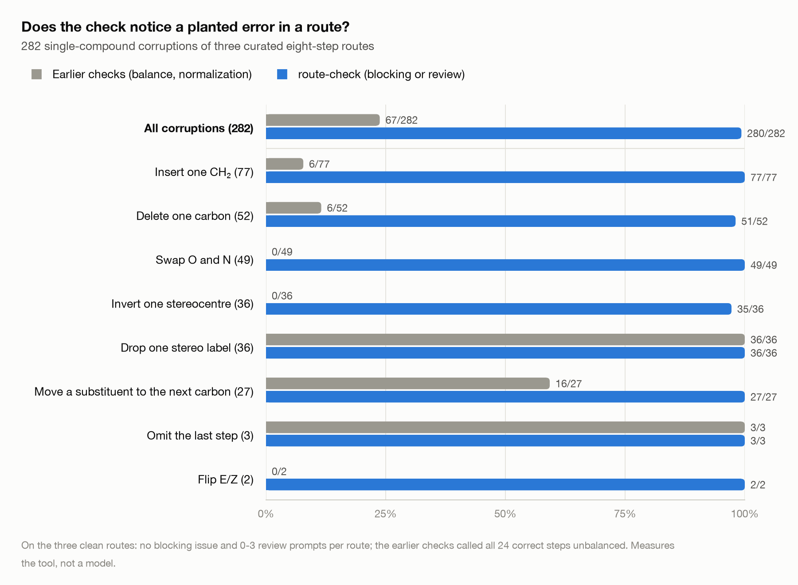
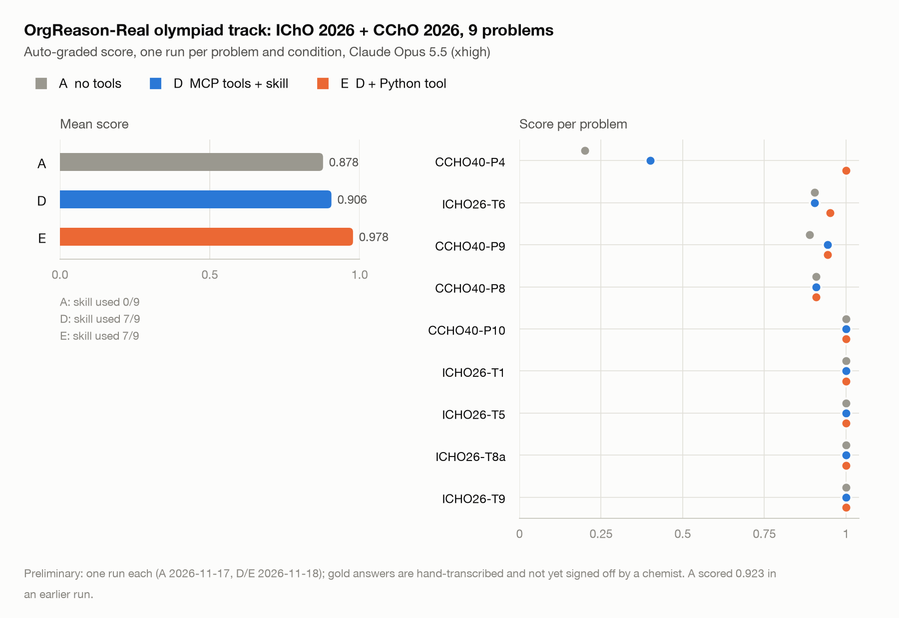
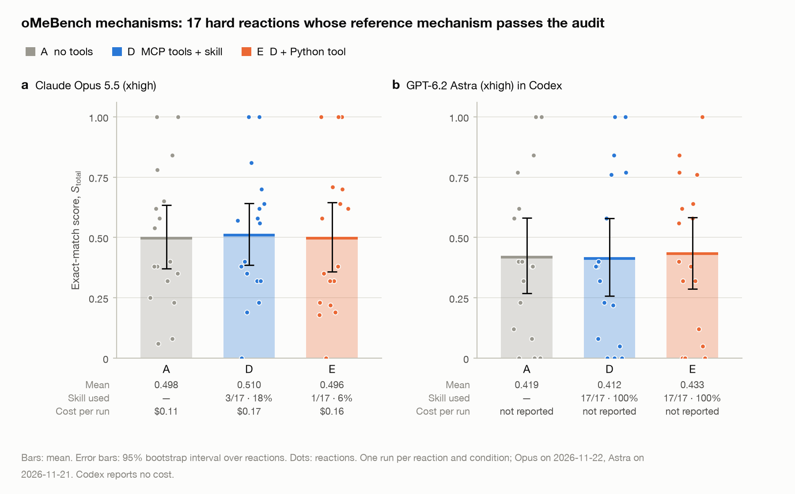
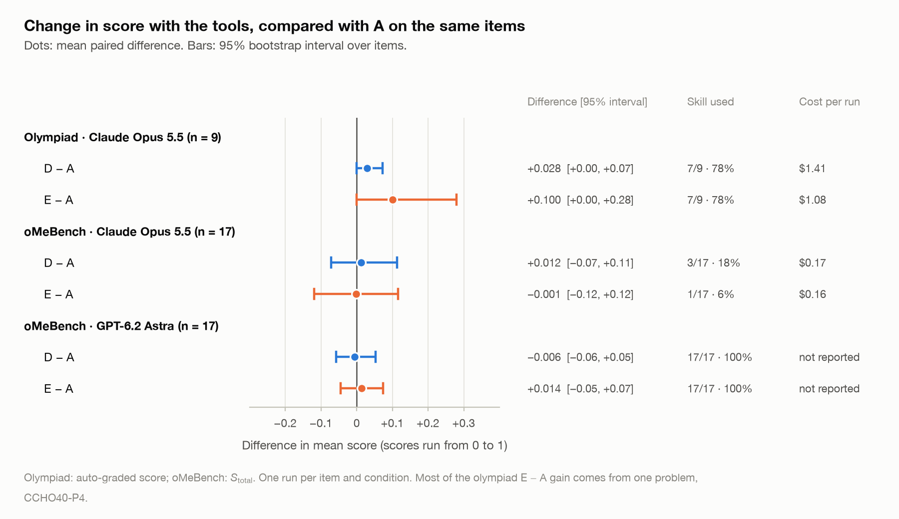

# Codex Organic Chemistry Assistant

**English** · [简体中文](README.zh-CN.md)

Check organic chemistry answers against molecular structures. Compare two stereoisomers, count substitution products, audit a sequence of mechanism intermediates, or follow a stereocentre through a proposed synthesis. Once the structures are right, draw the route or mechanism as a journal-style figure. The same RDKit-based tools run locally from the command line, from Python, and through the Model Context Protocol (MCP) in Codex or Claude Code.

[Quick start](#quick-start) · [Tools](#tools) · [Worked example](#worked-example) · [Figures](#figures) · [Benchmarks](#benchmarks) · [Documentation](#documentation)


## Quick start

Open this repository in Codex or Claude Code and ask it to **follow INSTALL.md and verify the installation**. For manual setup, start with [uv](https://docs.astral.sh/uv/) and run these commands from the repository root. The project requires Python 3.12+ and pins its dependencies in `uv.lock`.

```bash
uv sync --locked --extra mcp
uv run python scripts/check_install.py
```

The last line should read `install OK`. Try comparing the two configurations of 2-butanol.

```bash
uv run codex-chem compare --a 'C[C@H](O)CC' --b 'C[C@@H](O)CC'
```

Look for `"relation": "enantiomers"` in the JSON output. Both structures have formula C₄H₁₀O, and their only stereocentre is inverted.

**Using an assistant.** Claude Code discovers the project skill and reads the server definition in `.mcp.json`. Approve the server when prompted. In Codex, the skill is in `.agents/skills/`. Add the MCP server entry to `~/.codex/config.toml` using the absolute path of your checkout. The server registers 28 tools plus `chem://skill/...` resources, omits large SVG and Molblock strings from non-drawing tool outputs unless `include_drawings=true` is passed, and offers a 14-tool compact profile via `CODEX_CHEM_MCP_COMPACT=1`. [Connection instructions](INSTALL.md#4-connect-the-mcp-server-and-the-skill)

## Tools

The `organic-chemistry-assistant` skill helps the model choose a check for the claim it has made. You can also run the commands yourself or import `codex_organic_chem.kit` from Python.

| Question | Command | What to look for |
|---|---|---|
| How do these structures differ? | `compare` | Whether they are identical, enantiomers, diastereomers, tautomers, isotopologues/isotopomers or constitutional isomers, and which tetrahedral, E/Z or axial allene (`Ra`/`Sa`) centres differ. |
| How many possibilities are there? | `enumerate` | Stereoisomers, substitution products, or 3D symmetry-distinct ¹³C and ¹H environments (including diastereotopic groups) for NMR. |
| Are the drawn intermediates consistent with the stated conditions? | `route-check`, `mechanism-steps-check` | Formula and charge changes, mapped stereocentres and stereospecific alkene additions, functional groups that may react, or—for a stepwise mechanism list—intermediate valences, radical parity, proton-transfer skeleton invariance, and closure to the target. |
| Which face is more crowded? Can two atoms approach? | `model-kit` | IUPAC 2013 Re/Si facial shielding, blocking atoms, approach distances, dihedral populations, ring `cis`/`trans` relationships, embeddability, and relative isomer energies. |
| What structure is drawn in this image? | `crop-image`, `parse-image`, `parse-scheme` | Normalized `0.1`-step coordinate grids and 2× upscaled sub-crops for dense pages, stereo-preserving abbreviation expansion, and candidate structures from configured OCSR engines beside the source in the review workbench. |
| How can I draw a route or mechanism? | `route-figure`, `mechanism-validate`, `mechanism-render` | Multi-step schemes with one bond length throughout, as SVG and PNG, or curved-arrow mechanisms as SVG, CDXML and ChemDoodle JSON. Mechanism validation checks hydrogen and charge conservation and replays localized, intermolecular π, and aromatic electron moves. [Figures](#figures) |

Optional engines add GFN2-xTB energy and Fukui calculations (with UFF fallback when MMFF94 lacks B/Si parameters), CREST conformer searches, Open Babel file conversion and image recognition. Run `uv run codex-chem doctor` to see which are installed. For literature, `literature-search` queries OpenAlex with Crossref as a fallback and supports polite-pool contact headers (`CODEX_CHEM_MAILTO`), `OPENALEX_API_KEY`, bounded caching and retry backoff. [External tool setup](docs/external-tools.md)

## Worked example

**`route-check` takes a proposed synthesis as input.** Supply the target, numbered compounds as SMILES, and the reactants, product and conditions for each step. The eight-step hydroxyproline example shows what the audit examines. [Example input](tests/fixtures/routes/hydroxyproline_double_inversion.json) · [Route figure](#figures)

1. **Where did the atoms go?** The audit calculates which atoms were gained or lost and looks for a transformation consistent with that change and the named reagents. If reagent and byproduct structures are supplied, it includes them in the element and charge balance.
2. **What happened at the same stereocentre?** The tool maps atoms from reactant to product and follows the spatial arrangement of substituents to identify retention or inversion, plus stereospecific `E`/`Z`-alkene additions (concerted epoxidation/cyclopropanation/aziridination, *syn*-dihydroxylation, and *anti*-dihalogenation). An R/S label can change simply because substituent priorities changed.
3. **Which features of the drawing need an explanation?** The audit flags groups drawn unchanged under conditions that could affect them. It also compares the final product with the target centre by centre. In step 3, for example, only one of two esters reacts, so the report asks what accounts for the selectivity.

In Codex or Claude Code, give the assistant the route file and a question.

> Check `tests/fixtures/routes/hydroxyproline_double_inversion.json`. At which steps does C4 invert, and which selectivity questions still need review?

You can run the same audit from the command line.

```bash
uv run codex-chem route-check \
  --route tests/fixtures/routes/hydroxyproline_double_inversion.json --issues-only
```

In the reference route, C4 inverts at **steps 2 and 5**. The final product matches the target (`final_vs_target.relation` is `identical`). The audit reports zero `blocking` issues and three `review` prompts. A blocking issue is a conflict visible in the input, such as a final product with the wrong configuration. A review prompt is a question raised by atom mapping or reagent rules, such as the ester selectivity above. Experimental feasibility still needs literature or experimental evidence.

**What if just one intermediate is drawn incorrectly?** The command below opens two practice sessions. The route session changes only C4 of compound 7. The final product still matches the target, but two new `review` prompts appear. Step 5 now shows retention for an S<sub>N</sub>2 substitution expected to invert. In step 6, C4 appears to invert even though its bonded neighbours stay the same. Flip C4 of compound 7 back and apply the edit. Both prompts disappear.

```bash
uv run codex-chem review-demo --lang en
```

<details>
<summary>See compound 2 beside its source drawing</summary>


</details>

The workbench saves edits locally under `~/.codex-chem/reviews/` and returns them to the assistant. Its built-in editor supports stereocentre flips, R/S and E/Z assignments, SMILES and Molfile input. [Review controls and screenshots](docs/human-review.md)

**Auditing a stepwise mechanism sequence.** When a task asks for an ordered list of reaction intermediates rather than a multi-step synthesis or curved-arrow figure, `mechanism-steps-check` checks every intermediate's valence and radical parity, verifies heavy-atom skeleton invariance on proton transfers, attributes consecutive formula and charge deltas to the reactants or reagents, and confirms closure to the target product (flagging unfinished cascades that stop at a constitutional isomer).

```bash
uv run codex-chem mechanism-steps-check \
  --reaction "C=O.[C-]#N>C#N>OCC#N" \
  --steps '["[O-]CC#N", "OCC#N"]'
```

## Figures

**Draw the route you checked.** `route-figure` lays out structures and reaction conditions from a JSON spec as a multi-step scheme. The scheme below is the hydroxyproline route from the worked example, drawn with the ACS preset from [this spec](docs/examples/hydroxyproline-route-figure.json). [SVG master](docs/images/example-route-figure.svg)



- **One drawing, not a collage.** Every structure has the same bond length, line width and font size, whatever its size. Presets set these proportions for ACS- or RSC-style figures (`acs`, `rsc`) or for slides (`presentation`).
- **The core stays put.** Each structure given as SMILES is laid out with the part it shares with an earlier structure held at the same coordinates. In the scheme above, the Boc-protected pyrrolidine keeps its orientation through all nine structures. A Molfile keeps the layout from your editor and is only straightened.
- **Structures are parsed before they are drawn.** RDKit reads each SMILES or Molfile, and the result lists the canonical SMILES and InChIKey of every compound, so you can confirm the figure shows the structures you checked. Wedges and hashes come from the stereochemistry in the input.
- **The layout follows the structures.** Each cell is sized to its structure and caption, each arrow widens to fit its text, and digits in formulas such as `CH2Cl2` become subscripts while precatalyst generation tags such as `XPhos-Pd-G3` stay upright. Under each structure go a bold label, usually the compound number, and an optional grey line such as a name (including CJK text), wrapped when it is long; optional per-row `note` headers label convergent branches. With `max_width`, a long sequence wraps at arrows into rows of similar width.
- **An audit before `ok`.** Every render checks for overlapping elements, uneven bond lengths and text that would be clipped. Any problem turns the status into `ok_with_warnings` or `blocked_for_publication`.
- **SVG first.** The SVG is the master for further editing. A PNG preview is also written when Chrome, Inkscape, ImageMagick or rsvg-convert is installed.

Describe the scheme to the assistant, or point it at a route file.

> Draw `tests/fixtures/routes/hydroxyproline_double_inversion.json` as an ACS-style scheme with three steps per row, reagents above the arrows and solvent and temperature below.

To draw the scheme above from the command line, run:

```bash
uv run codex-chem route-figure --spec docs/examples/hydroxyproline-route-figure.json \
  --output-dir outputs/route_figure --format svg --format png
```

<details>
<summary>What a route spec looks like</summary>

```json
{
  "style_preset": "acs",
  "rows": [
    {
      "items": [
        {"label": "1", "code": "hydroxyproline ester", "smiles": "COC(=O)[C@@H]1C[C@@H](O)CN1"},
        {"type": "arrow", "label": "Boc2O, Et3N", "sublabel": "CH2Cl2, rt"},
        {"label": "2", "code": "N-Boc", "smiles": "COC(=O)[C@@H]1C[C@@H](O)CN1C(=O)OC(C)(C)C"}
      ]
    }
  ],
  "footnotes": ["Ar = 4-nitrophenyl."]
}
```

Rows are drawn left to right, top to bottom. `label` is the bold line under a structure and `code` the grey line below it. A row can also contain `plus` and short `text` items. Add `"max_width": 1100` to wrap long rows at arrows. Core alignment and subscripts are on by default; `"align_structures": false` and `"subscript_formulas": false` turn them off. `uv run codex-chem route-figure --example` prints a complete spec.

</details>

`route-check --figure-dir DIR` draws an audited route in the same run, with no spec to write. Compound numbers are bold with the names underneath, reagents go above each arrow and solvent and temperature below, and the steps wrap into rows of similar width. Write a spec when you want to choose the rows and captions yourself.

**Mechanisms.** `mechanism-render` draws curved-arrow mechanisms from an atom-mapped spec. Each arrow starts at a lone pair or a bond and ends at an atom or a bond, including intermolecular π-bond attacks and active Kekulé or spectator aromatic rings. `mechanism-validate` replays the electron moves of each step and checks hydrogen, charge and spectator-counterion conservation before anything is drawn. Besides the SVG (with optional teaching-mode lone pairs and partial charges), the renderer writes spec-compliant CDXML for ChemDraw, ChemDoodle JSON and a step-by-step trace. [Mechanism and route figures](docs/figures.md)



## Benchmarks

When a problem gives the number of monosubstitution products, an assistant can enumerate those products for each candidate skeleton and rule out structures that give the wrong count. When it drafts a synthesis, it can trace a stereocentre to find the intermediate that needs redrawing. We built structure checks for these tasks and wrote a skill that tells the model when to use them and how to revise an answer.

### How often does the model use the skill?

We rewrote the skill description to include olympiad problems, page images and familiar-looking structure questions. The MCP server also reminds the model to load the skill on connection. The aim is for the model to choose a check, such as `enumerate` for an isomer count, while it is still working out the answer.

This works for some kinds of question and not yet for others. In a trigger test on olympiad items (panel a), Claude Opus 5.5 loaded the skill **as its first action** in 3/18 sessions with the old description and 16/18 with the revised description and server reminder. The revised description alone gave 9/9, so the reminder’s additional contribution is uncertain. On similarly worded questions outside the skill’s scope, it loaded the skill first in 0/24 sessions. In benchmark runs with tools (panel b), **skill use at any point** on the olympiad pages rose from 3/18 to 14/18. On the [oMeBench](#do-the-checks-help-on-public-benchmarks) mechanism prompts, which assign a persona, require strict JSON and give the product, the same configuration used the skill in only **4/34** runs, while GPT-6.2 Astra in Codex read it in all 34. The description reaches exam-style and open questions, but not tightly formatted benchmark prompts.

<picture>
  <source media="(prefers-color-scheme: dark)" srcset="docs/images/skill-loading.en.dark.png">
  
</picture>

### Does a single route error give the model something to investigate?

Flipping a wedge can leave a structure perfectly readable, with the same formula and charge. By mapping atoms and tracking configuration across each step, the audit can point out unexpected retention or inversion and give the model a specific intermediate to revisit.

Starting from three eight-step reference routes, we generated **282 variants** with one edit apiece, such as inverting a stereocentre, moving a substituent or omitting the last step. Each variant was compared with its own unmodified route. The earlier tools normalized each structure and checked the balance between the listed reactants and the main product. With the steps written in this abbreviated form, they flagged all 24 unmodified steps as unbalanced. [Benchmark script](scripts/benchmark_route_check.py)

| Edit | Earlier tools produced a different normalization warning or balance status | `route-check` produced a new `blocking` issue or `review` prompt |
|---|---:|---:|
| All variants | 67/282 | **282/282** |
| Invert one stereocentre | 0/36 | 36/36 |
| Move a substituent to the adjacent carbon | 16/27 | 27/27 |

Of the 282 variants that produced a new diagnostic, **83** introduced a blocking issue (including concerted `E`/`Z`-alkene epoxidation stereochemistry mismatches and unsubstantiated alkoxide/alcohol losses). The reference routes had zero blocking issues and zero to three review prompts per route. Any new diagnostic at either severity counts. Establishing whether it identifies the planted error or helps an assistant repair the route would require scoring the diagnosis and the repair.

```bash
uv run python scripts/benchmark_route_check.py --output-dir outputs/route_check_benchmark
```

<details>
<summary>Detection rate for every kind of edit, with 95% intervals</summary>

<picture>
  <source media="(prefers-color-scheme: dark)" srcset="docs/images/route-audit.en.dark.png">
  
</picture>

</details>

### Do the checks help the model solve whole problems?

In our internal OrgReason-Real evaluation, Claude Opus 5.5 (xhigh) received page images of nine IChO and CChO organic chemistry problems. Answers were auto-graded field by field, with one run per problem and condition. We ran A on November 17, 2026 and D and E the following day. Condition D provided the predefined checks. Condition E also let the model write Python with RDKit to test a question specific to the problem.

| Condition | Mean auto-graded score | Runs using the skill | Mean cost per run |
|---|---:|---:|---:|
| A · No tools | 0.878 | — | $0.96 |
| D · MCP tools and skill | 0.906 | 7/9 | $1.41 |
| E · D plus the optional Python tool | 0.978 | 7/9 | $1.08 |

<picture>
  <source media="(prefers-color-scheme: dark)" srcset="docs/images/orgreason-real.en.dark.png">
  
</picture>

One polycyclic hydrocarbon problem, CCHO40-P4, illustrates what a custom check made possible. In E, the model cropped the structures from the page, built a molecular graph from the drawing, and used RDKit to enumerate and deduplicate candidate structures. The scores on this problem were 0.20 (A), 0.40 (D) and 1.00 (E). It accounted for most of the gap between D and E.

Five of the nine problems received full marks under every condition. An earlier no-tools run averaged 0.923, and the hand-transcribed answers used for grading still await chemist review. Estimating a repeatable gain, or the contribution of an individual tool such as `route-check`, would require repeated runs and comparisons with that tool enabled and disabled. The olympiad harness, problems and run records are internal. The Chinese Chemical Society’s CChO problems are used only for internal evaluation.

### Do the checks help on public benchmarks?

[oMeBench](https://arxiv.org/abs/2510.07731) asks for a reaction mechanism as a list of intermediates and scores it step by step against a reference mechanism (S<sub>total</sub>, from 0 to 1). Before comparing conditions, we checked the reference mechanisms with rules that do not depend on any model's answers: atoms must balance at every step, the last intermediate must be the given product, and valences and radicals must be plausible. 51 of the 196 reference mechanisms failed, including 6 of the 23 hard ones. Both models answered the 17 hard reactions that passed, once per reaction and condition, on November 21 and 22, 2026.

| Model | Condition | Mean S<sub>total</sub> | Runs that loaded the skill | Mean cost per run |
|---|---|---:|---:|---:|
| Claude Opus 5.5 (xhigh) | A · No tools | 0.498 | — | $0.11 |
| | D · MCP tools and skill | 0.510 | 3/17 | $0.17 |
| | E · D plus the optional Python tool | 0.496 | 1/17 | $0.16 |
| GPT-6.2 Astra (xhigh) in Codex | A · No tools | 0.419 | — | not reported |
| | D · MCP tools and skill | 0.412 | 17/17 | not reported |
| | E · D plus the optional Python tool | 0.433 | 17/17 | not reported |

<picture>
  <source media="(prefers-color-scheme: dark)" srcset="docs/images/omebench.en.dark.png">
  
</picture>

Neither model scored measurably higher with the tools. D minus A was +0.01 for Opus (95% bootstrap interval −0.07 to +0.11) and −0.01 for Astra (−0.06 to +0.05). The two models differ in how often they loaded the skill. Opus usually answered the formatted prompt directly. In the four runs where it loaded the skill, it compared structures, analysed the reaction or ran Python, but never called `mechanism-validate`, probably because the skill presents mechanism validation for curved-arrow figures while oMeBench asks for a list of intermediates. Astra read the skill in every tool-enabled run and still showed no gain. Single runs are noisy: two condition A runs of Opus on the same 17 reactions averaged 0.511 and 0.498, but individual reactions moved by 0.107 on average, so effects smaller than about 0.1 need repeated runs. (`mechanism-steps-check` and its skill guidance were added after these November 21–22 runs specifically to audit intermediate SMILES sequences without requiring curved-arrow specs; measuring their effect on oMeBench awaits repeated evaluation.)

The figure below puts both benchmarks on one scale: the change from A to D and from A to E on the same items. On oMeBench, all four intervals span zero. On the olympiad, both intervals start at zero: 7 of the 9 problems scored the same in D as in A, and 6 of 9 in E, so the mean gain rests on two or three problems, mostly CCHO40-P4.

<picture>
  <source media="(prefers-color-scheme: dark)" srcset="docs/images/tool-effect.en.dark.png">
  
</picture>

**Probes that were too easy.** Before running every condition on a benchmark, we check whether the model already solves it without tools. Three candidates came close to full marks, so they cannot show what the tools add. Each probe used 20 items drawn with a fixed seed by rules set before any run: SUPERChem questions whose text or options contain an organic structure, and two items from each of ten size bands of ChemIQ’s 2D NMR set.

| Benchmark (20 items) | Claude Opus 5.5, no tools | GPT-6.2 Astra, no tools |
|---|---:|---:|
| [SUPERChem](https://arxiv.org/abs/2512.01274) organic multiple choice, structures given as SMILES | 19/20 | 17/20 |
| The same SUPERChem items, structures given as images | 17/20 | — |
| [ChemIQ](https://github.com/oxpig/ChemIQ) structure from the formula and ¹H, ¹³C, COSY, HSQC and HMBC data | 19/20 | — |

In the image version, one of the three misses was a run that an API safety filter stopped before it answered. For the 2D NMR set, the ChemIQ authors report 20% for the best model they tested. All three benchmarks were public before these models’ training cutoffs, so we cannot tell how much of the high scores comes from the models having seen the questions. The skill and tool conditions were not run on these sets. As with the olympiad, the harness and run records are internal; the benchmarks themselves are public.

## Documentation

- [Installation and troubleshooting](INSTALL.md) covers the environment, host configuration and install checks.
- [Verification kit](docs/verification-kit.md) covers structure comparison, enumeration, route audits, stepwise mechanism-intermediate checks, conformer analysis and synthesis suggestions. The [Python API reference](.agents/skills/organic-chemistry-assistant/references/kit-api.md) describes arguments and return values.
- [Skills and MCP tools](docs/skills-and-mcp.md) lists the tools, the optional Python tool and the Claude Code route-review subagent.
- [Mechanism and route figures](docs/figures.md) includes worked examples, SVG and CDXML output, and editor integrations.
- [Dependencies](DEPENDENCIES.md) and the [changelog](CHANGELOG.md) document package requirements and release history.

## License

The project uses the [MIT License](LICENSE). The bundled ChemDoodle Web Components use GPLv3 or a separate commercial license from iChemLabs. [Third-party notices](THIRD_PARTY_NOTICES.md)
