# Codex 有机化学助手

[English](README.md) · **中文**

这是一套在本地运行的工具链，让 AI 助手能在结构层面核查有机化学问题：

- 模型先推理，再用一组"对错结果不同"的检查去推翻自己的答案。结构、路线或计数一旦有错，检查结果就会和正确时不一样。
- 从图片里读出的结构、准备付诸实施的路线，会交给化学专家在审核页面上确认。
- 确认后的结构可以画成路线图和机理图。

整套东西包括一个 Python 包（命令行、MCP 服务器和 kit）、一个同时适用于 Claude Code 和 Codex 的 skill，以及一个浏览器审核工作台。

<p align="center">
  
  <br>
  <sub>审核工作台。C4 羟基被误读成虚楔键，点一下这个中心就改好了，页面同时说明改动后的结构与原结构是什么关系。<a href="docs/images/review-structures.en.png">English</a></sub>
</p>

> 这是研究助手，不是安全权威。合成、机理和计算方面的建议都只是假设，需要查文献并由专家验证。

**目录：**
[包含什么](#包含什么) ·
[各部分如何配合](#各部分如何配合) ·
[功能](#功能) ·
[基准测试](#基准测试) ·
[快速开始](#快速开始) ·
[在 Claude Code 和 Codex 中使用](#在-claude-code-和-codex-中使用) ·
[文档](#文档) ·
[目录结构](#目录结构) ·
[许可证](#许可证)

## 包含什么

| 部分 | 是什么 | 位置 |
|---|---|---|
| 工具链 | 基于 RDKit 的 Python 包，包括 `codex-chem` 命令行、`codex-chem-mcp` MCP 服务器（26 个工具），以及可在 Python 里直接调用的 `codex_organic_chem.kit`。可选引擎：GFN2-xTB、CREST、Open Babel 和多个 OCSR 模型。 | `src/codex_organic_chem` |
| Skill | `organic-chemistry-assistant`：先推理，再设法推翻，然后修正。它附有一张表，写明每类结论该用哪项检查去推翻。路线规划、反应结果、结构输入、作图、kit API 等任务说明按需加载。另有一个 `chem-route-critic` 子代理，用来对路线做独立的二次审读。 | `.claude/skills`、`.agents/skills`、`.claude/agents` |
| 审核工作台 | 浏览器页面，化学专家在上面确认或改正结构和路线，支持中英文。不需要构建，改正结果以数据形式返回。 | `src/codex_organic_chem/review_ui` |

## 各部分如何配合

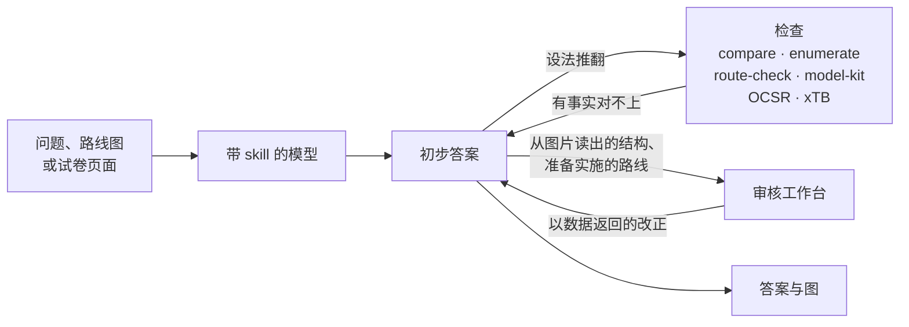

Skill 告诉模型：哪项检查能推翻哪类结论，每个结果该怎么看。MCP 服务器在连接时也会提示客户端：调用工具之前先加载 skill。

## 功能

### 会失败的检查

模型刚写下的 SMILES，拿去解析一遍几乎不会失败，也就说明不了什么。下面这些检查能真正发现错误：

| 命令行 / MCP 工具 | 回答什么问题 |
|---|---|
| `compare` / `chem_compare_structures` | 两个结构是同一化合物、对映体、非对映体还是构造异构体，哪些立体中心不同。 |
| `enumerate` / `chem_enumerate` | 有多少个立体异构体或取代产物；有多少种对称性不等价的 C、H 环境，即 NMR 信号数。 |
| `route-check` / `chem_route_check` | 逐步检查：分子式的变化能否由条件里的试剂解释；每个立体中心是保持、翻转、消失还是新生成（按原子映射下的空间排布判断，不看 CIP 字母）；画成不变的基团里，哪些会被这一类试剂进攻（共 33 类）；哪些原子追踪不到来源。整条路线：最终产物与目标逐个中心比对。 |
| `model-kit` / `chem_model_kit` | 用构象系综回答三维问题：哪一面被屏蔽、被哪些原子屏蔽，两个原子能否靠近，反式共平面构象的比例，是否共平面，某种稠环能否存在，哪个异构体能量更低（可用 GFN2-xTB 精修）。 |

```bash
uv run codex-chem compare --a "C[C@H](O)CC" --b "C[C@@H](O)CC"        # 对映体
uv run codex-chem enumerate --smiles "CC1CCCCC1" --task substitution   # 5 种构造异构，计立体共 12 种
uv run codex-chem enumerate --smiles "OCC(O)CO" --task environments    # 2 种 C 环境、5 种 H 环境
uv run codex-chem route-check --example > route.json
uv run codex-chem route-check --route route.json --issues-only
```

`blocking` 是确定的问题；`review` 是基于经验规则的提示。详见 [docs/verification-kit.md](docs/verification-kit.md) 和 [kit API 参考](.agents/skills/organic-chemistry-assistant/references/kit-api.md)。

### 从图片读结构

`parse-image` 先把截图做几种预处理，再交给已配置的 OCSR 引擎识别。默认用 MolScribe，可选 DECIMER、MolGrapher、OpenChemIE、OSRA 和 ChemSchematicResolver。每个候选结构都连同警告一起保留；只有一个引擎读出、没有第二个引擎印证的结果会被标出来。`parse-scheme` 还能处理 R 基团定义，并对路线中可能读错的跳变给出警告。在一张有难度的 9 个截图的测试路线图上，所有开源引擎都没能完全读对。所以默认情况下，从图片读出的结构都要先在审核工作台确认，再往下用。

### 审核工作台

**结构。** 每个结构旁边是它所读自的原图，附有助手的读图说明、要问的问题和备选读法。审核人可以：
- 点击立体中心翻转；
- 用 R/S、E/Z 按钮指定未定义的中心和双键；
- 直接改 SMILES、粘贴 Molfile，或者在 Ketcher 里手绘。

页面会立即说明改动后的结构与原结构是什么关系（见本页开头的图）。

**路线。** `route-review` 把 `route-check` 的核查结果按步骤展开，并在每个产物上高亮发生变化的立体中心。改动结构或反应条件后，核查会立即重跑。审核人可以把每一步标为对或错，逐条回答核查提示，最后通过或退回整条路线。

<p align="center">
  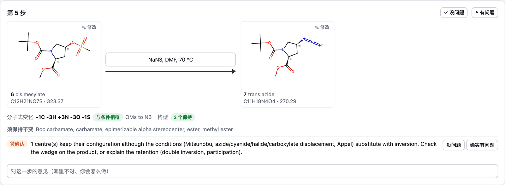
  <br>
  <sub>练习路线的第 5 步：叠氮的 SN2 取代被画成了构型保持，核查给出了提示。</sub>
</p>

<details>
<summary>更多截图（中文和 English）</summary>

| 中文 | English |
|---|---|
| [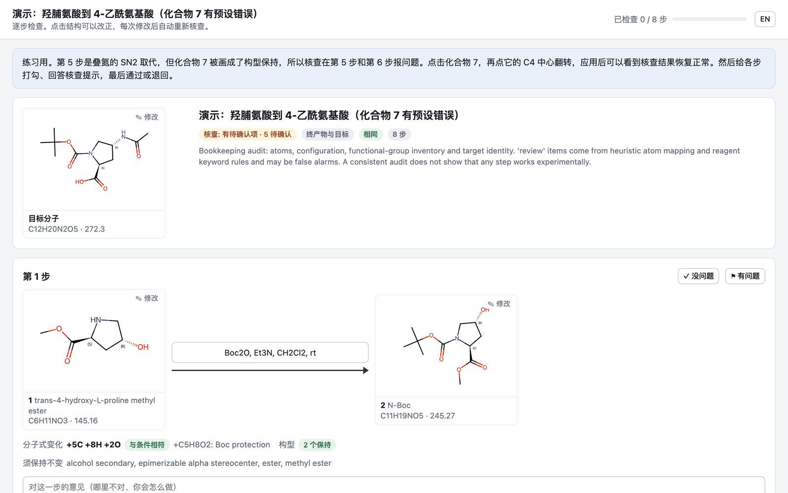](docs/images/review-route.zh.png) | [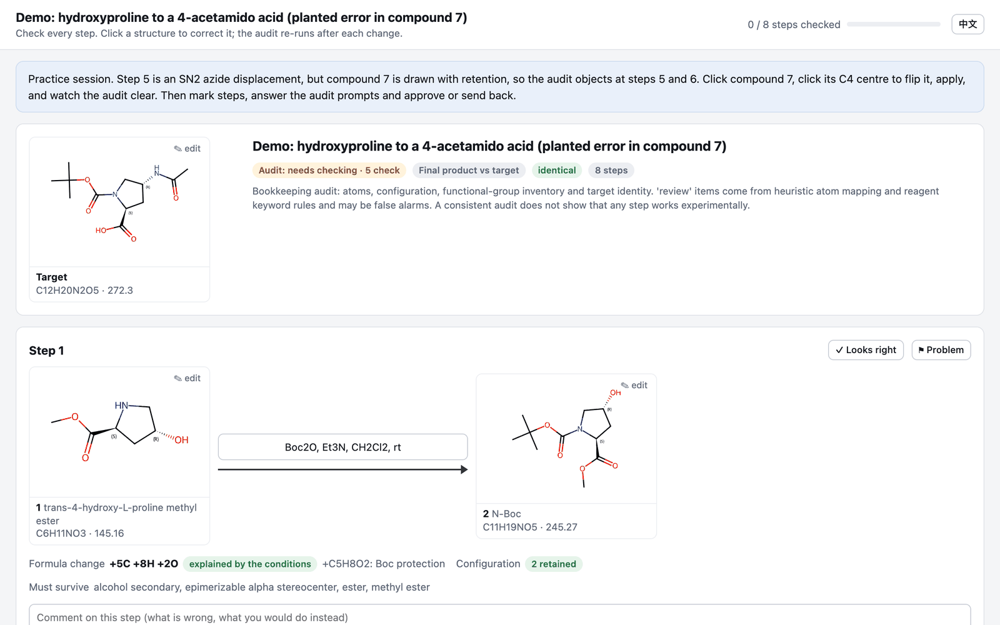](docs/images/review-route.en.png) |
| [](docs/images/review-route-step.zh.png) | [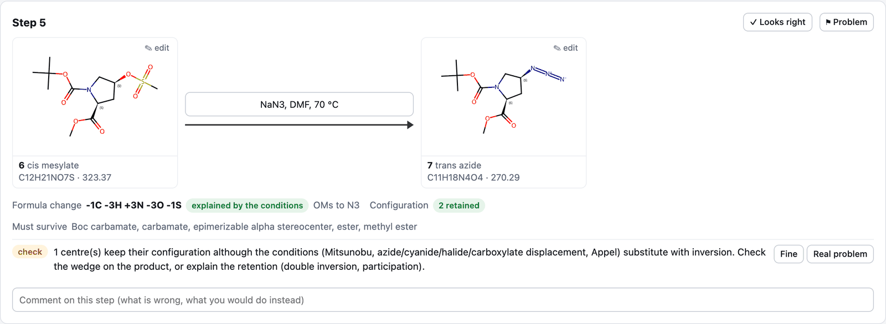](docs/images/review-route-step.en.png) |
| [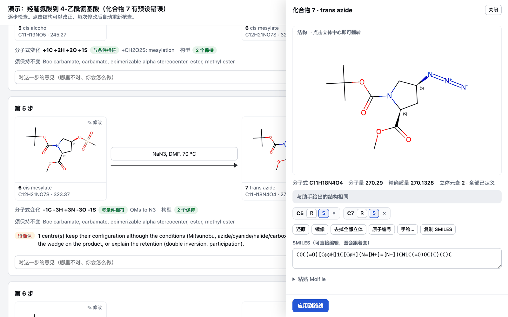](docs/images/review-route-editor.zh.png) | [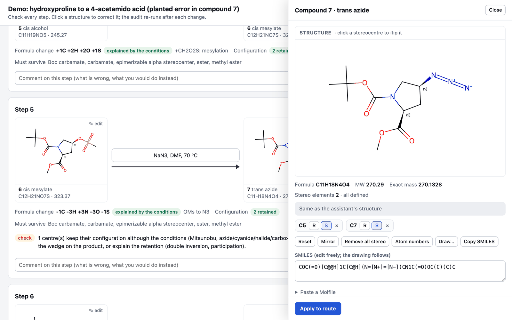](docs/images/review-route-editor.en.png) |
| [](docs/images/review-structures.zh.png) | [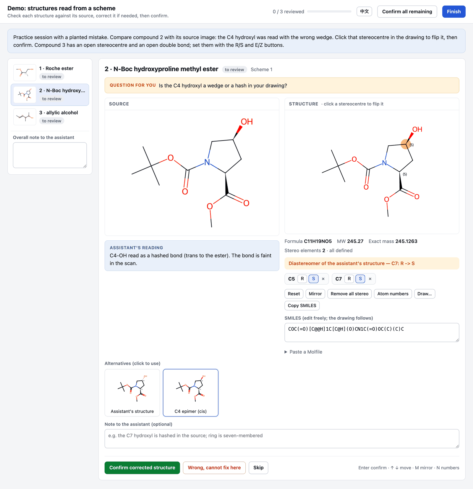](docs/images/review-structures.en.png) |

</details>

- **会话会保留：** 审核会话不随打开它的命令结束。后台有一个小服务器保持页面在线，每次改动都保存在 `~/.codex-chem/reviews/` 下。
- **何时打开页面：** 由 `review-mode auto|ask|off` 决定：遇到需要审核的环节时，助手直接打开页面、先问一句，或者不打开。
- **练习：** `codex-chem review-demo` 会打开两个带预设错误的练习会话，加 `--lang zh` 显示中文。

详见 [docs/human-review.md](docs/human-review.md)。

### 作图

- **路线图：** `route-figure` 把审核过的结构排成一张路线图，输出一个 SVG 主文件和一张 PNG。
- **机理图：** `mechanism-render` 根据带原子映射的机理描述（MechanismSpec 2.1）画出电子转移箭头。画图前先验证机理：原子、氢和电荷是否守恒，每组电子转移在下一个状态里能否复现。
  - 可导出 SVG、CDXML、ChemDoodle、Ketcher 和 Marvin 文件。
  - 箭头缺少电子来源或去向时，拒绝作为发表用图输出。

<p align="center">
  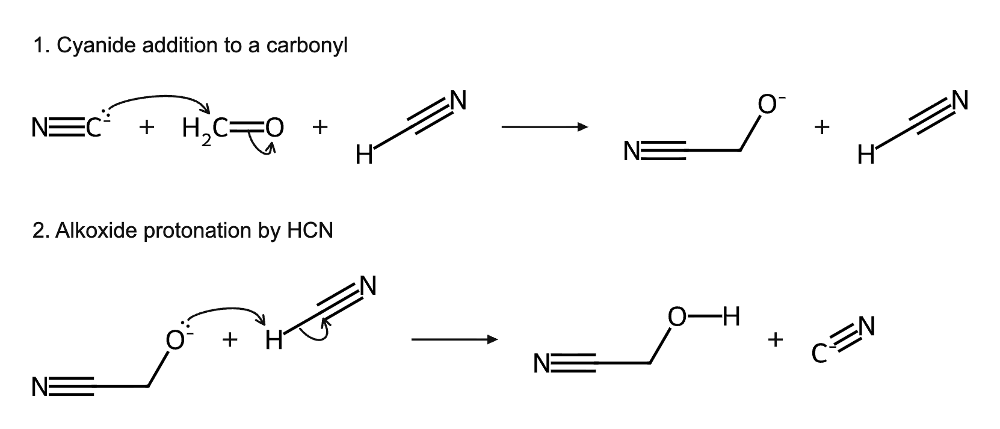
  <br>
  <sub>氰醇生成，是机理测试集中的一个精选案例。路线图示例见 <a href="docs/figures.md">docs/figures.md</a>。</sub>
</p>

### 计算与文献

- RDKit：结构规范化、描述符、构象、电荷和画图。
- GFN2-xTB：几何优化与能量、Fukui 指数与电荷、频率与自由能校正。CREST：构象系综及其布居。装了才会用，`codex-chem doctor` 会告诉你缺什么。
- `literature-search`：从 OpenAlex 取摘要、引用数和开放获取链接，Crossref 作为后备。`synthesis-suggest` 用于交互式头脑风暴，每次只讨论一个切断。

## 基准测试

下面三个问题分别单独测量，数字来自我们自己的测试运行。测评框架、题目和运行记录不在本仓库中。

### 模型会自己加载 skill 吗？

从不加载的 skill 起不了作用。在 2026-11-17 的 OrgReason-Real 运行中，Claude Opus 5.5 在 18 次运行里只加载了 3 次。改写 skill 描述并给 MCP 服务器加上说明之后，18 次里加载了 14 次。

<picture>
  <source media="(prefers-color-scheme: dark)" srcset="docs/images/skill-loading.zh.dark.png">
  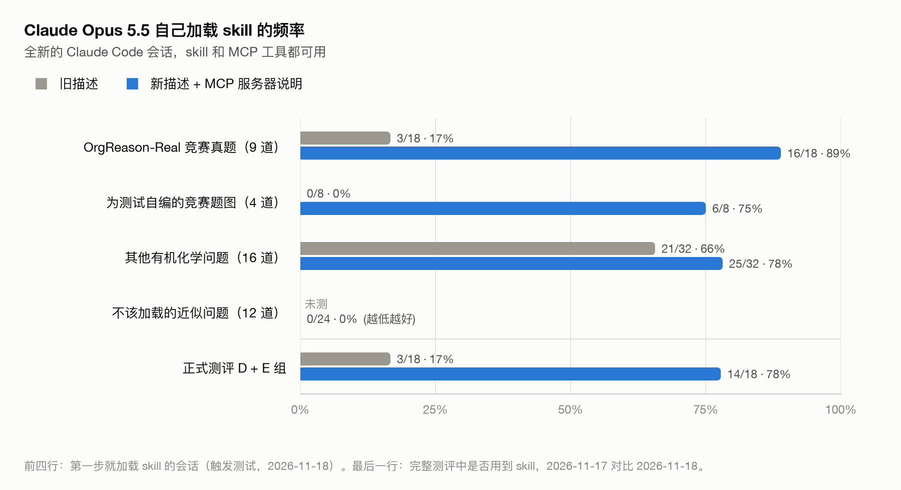
</picture>

| 会话（Opus 5.5，xhigh） | 旧描述 | 新描述 + MCP 服务器说明 |
|---|---|---|
| OrgReason-Real 竞赛真题（9 道），第一步就加载 | 3/18 | 16/18（含无服务器说明的运行共 25/27） |
| 为测试自编的竞赛题图（4 道），第一步就加载 | 0/8 | 6/8 |
| 其他有机化学问题（16 道），第一步就加载 | 21/32 | 25/32 |
| 不该加载的近似问题（12 道） | 未测 | 0/24 |
| 正式测评 D + E 组，运行中用到 | 3/18 | 14/18 |

模型觉得能当场回答的问题，仍会跳过 skill，比如数异构体、画椅式构象、卤仿反应。

### route-check 能发现埋下的错误吗？

在三条精选的 8 步路线里，每次只改坏一个化合物。改法包括：翻转一个立体中心、去掉一个楔形键、E/Z 翻转、少一个碳、多一个 CH₂、O 和 N 互换、取代基挪位、漏掉最后一步。

<picture>
  <source media="(prefers-color-scheme: dark)" srcset="docs/images/route-audit.zh.dark.png">
  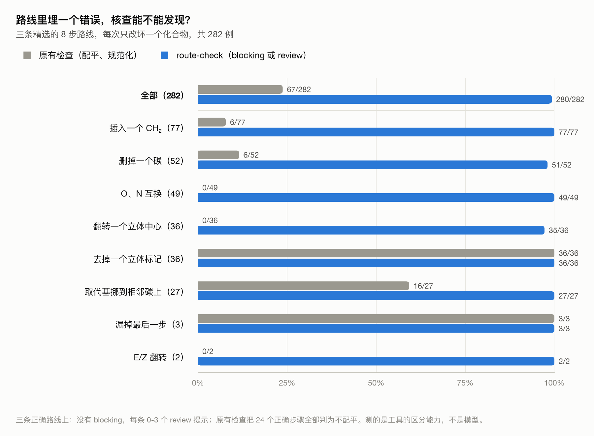
</picture>

| | 原有检查（配平、规范化） | route-check（blocking 或 review） |
|---|---|---|
| 输出因错误而改变 | 67/282（24%） | 280/282（99%） |
| 24 个正确步骤上的误报 | 全部判为不配平 | 没有 blocking，每条路线 0-3 个 review 提示 |

这里测的是反馈能不能区分对错，不是模型会不会根据反馈采取行动。复现命令：`uv run python scripts/benchmark_route_check.py --output-dir outputs/route_check_benchmark`。

### 在真实竞赛题上有帮助吗？

OrgReason-Real 使用 IChO 2026 和 CChO 2026 中的 9 道有机题。题目以页面图片发送，按小题逐项与人工转写的标准答案比对评分。三个条件：
- **A：** 不给工具；
- **D：** 加上 MCP 工具和 skill；
- **E：** 在 D 的基础上再加一个可选的 Python 工具。

<picture>
  <source media="(prefers-color-scheme: dark)" srcset="docs/images/orgreason-real.zh.dark.png">
  
</picture>

| 条件（Opus 5.5，xhigh） | 自动评分平均分 | 用到 skill | 每次花费 |
|---|---|---|---|
| A，无工具（2026-11-17） | 0.878 | – | 0.96 美元 |
| D，MCP 工具 + skill（2026-11-18） | 0.906 | 7/9 | 1.41 美元 |
| E，D + Python 工具（2026-11-18） | 0.978 | 7/9 | 1.08 美元 |

这些数字只能算初步结果：

- 每道题在每个条件下只跑了一次。A 组在更早的一次运行中得 0.923，单次运行的波动约 0.05。
- 9 道题里有 5 道在所有条件下都是满分。E 组的领先主要来自一道题（CCHO40-P4：A 0.20，D 0.40，E 1.00）。
- 标准答案是人工转写的，尚未经化学专家签字确认。
- CChO 题目版权属于中国化学会，只用于内部评测。

要说准确率有提升，还需要重复多跑几次。

## 快速开始

最简单的方式：用 Claude Code 或 Codex 打开本仓库，让它安装这个项目。[INSTALL.md](INSTALL.md) 就是为此写的，`CLAUDE.md` 和 `AGENTS.md` 会把代理引到这份说明。代理会装好环境、做自检，并连接 MCP 服务器。

也可以手动安装。需要 [uv](https://docs.astral.sh/uv/)，它会准备好 Python 3.12，并按 `uv.lock` 锁定的版本安装所有依赖：

```bash
uv sync --locked --extra mcp
uv run python scripts/check_install.py    # 最后一行应为 "install OK"
uv run codex-chem compare --a "C[C@H](O)CC" --b "C[C@@H](O)CC"
uv run codex-chem review-demo --lang zh   # 两个练习用的审核页面
```

可选引擎（xTB、CREST、Open Babel、OCSR 模型、Ketcher）的安装和常见问题见 [INSTALL.md](INSTALL.md)。

## 在 Claude Code 和 Codex 中使用

- **Claude Code：** 把本仓库作为工作目录打开，在提示时批准 MCP 服务器。`.claude/skills/organic-chemistry-assistant` 里的 skill 和 `.mcp.json` 里的服务器会自动加载。
- **Codex：** skill 放在 `.agents/skills/organic-chemistry-assistant`，`~/.codex/config.toml` 里要加的 MCP 服务器配置见 [INSTALL.md](INSTALL.md#4-connect-the-mcp-server-and-the-skill)。

另外两点：
- **每个环境只保留一份 skill：** 别处装过的同名旧版本（比如用户级 skill 或同步到账号的 skill）会和这份并列出现，模型可能加载其中任何一个。
- **没有 shell 的环境：** 可以用 `CODEX_CHEM_ENABLE_PYTHON=1` 打开 `chem_python` 工具。

详见 [docs/skills-and-mcp.md](docs/skills-and-mcp.md)。

## 文档

详细文档目前只有英文。

| 主题 | 位置 |
|---|---|
| 核查工具包、路线核查、合成建议 | [docs/verification-kit.md](docs/verification-kit.md) |
| Skill、MCP 服务器、工具清单 | [docs/skills-and-mcp.md](docs/skills-and-mcp.md) |
| 审核工作台 | [docs/human-review.md](docs/human-review.md) |
| 机理图、路线图、编辑器集成 | [docs/figures.md](docs/figures.md) |
| 可选引擎（xTB、CREST、OCSR、ChemDraw、Ketcher 等） | [docs/external-tools.md](docs/external-tools.md) |
| Kit API 和 skill 的任务说明 | [.agents/skills/organic-chemistry-assistant/references](.agents/skills/organic-chemistry-assistant/references) |
| 依赖与许可 | [DEPENDENCIES.md](DEPENDENCIES.md)、[THIRD_PARTY_NOTICES.md](THIRD_PARTY_NOTICES.md) |
| 更新记录 | [CHANGELOG.md](CHANGELOG.md) |

## 目录结构

```text
src/codex_organic_chem/      命令行、MCP 服务器、kit、审核工作台（review_ui/）
.claude/skills/              Claude Code 用的 skill
.claude/agents/              chem-route-critic 子代理
.agents/skills/              Codex 用的同一个 skill
integrations/ketcher/        审核页面可选的 Ketcher 编辑器
integrations/chemdoodle/     可选的 ChemDoodle Web Components 查看器
scripts/                     安装脚本、工具基准测试、OCSR 适配器、README 图表
docs/                        详细文档和图片
tests/                       pytest 测试
```

## 许可证

MIT，见 [LICENSE](LICENSE)。可选的 ChemDoodle Web Components 文件属于第三方，采用 GPLv3/商业许可，见 [THIRD_PARTY_NOTICES.md](THIRD_PARTY_NOTICES.md)。本页图表由 `scripts/make_readme_figures.py` 生成。
