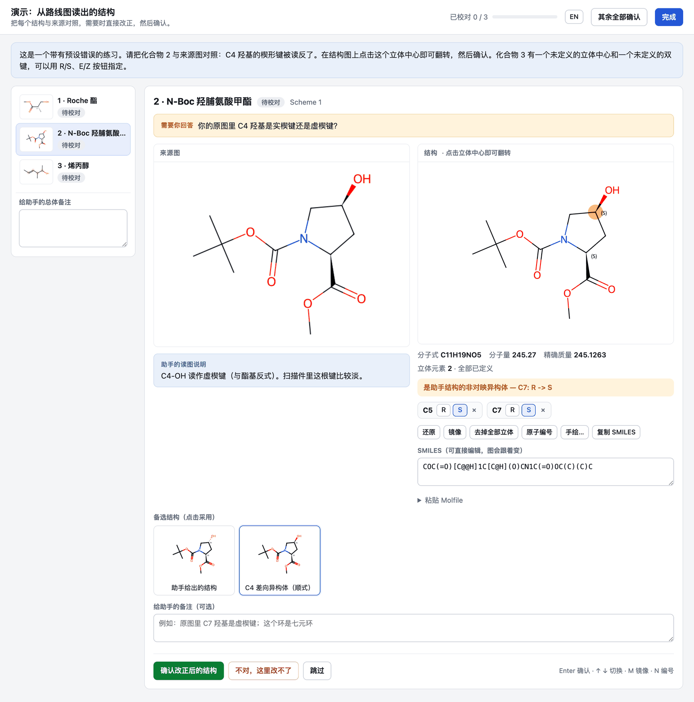
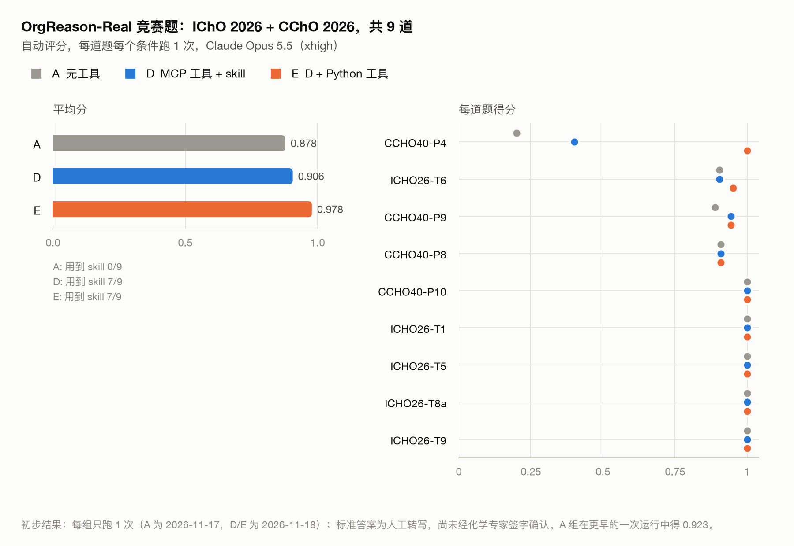
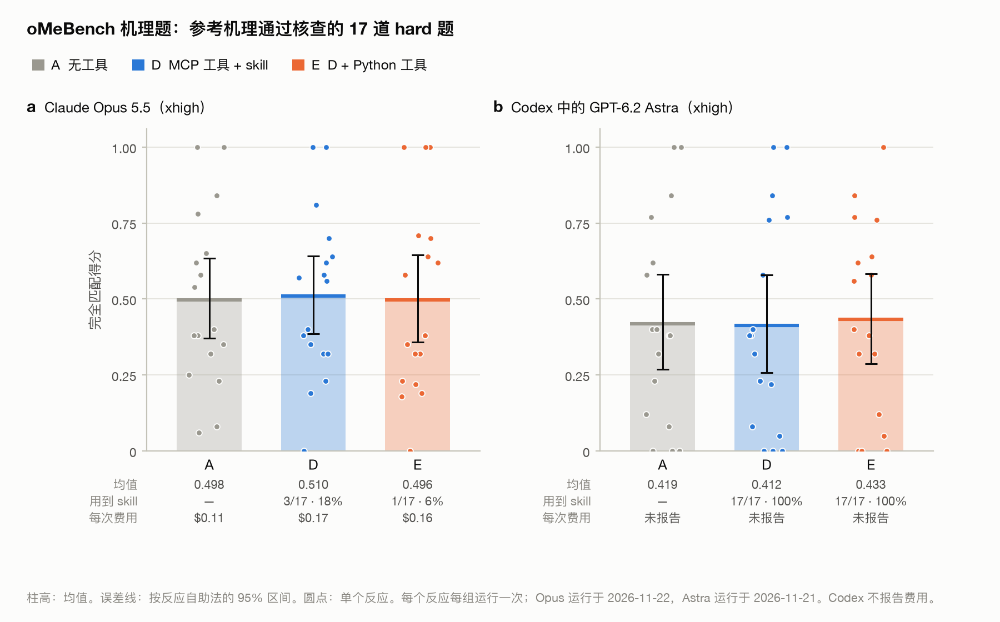
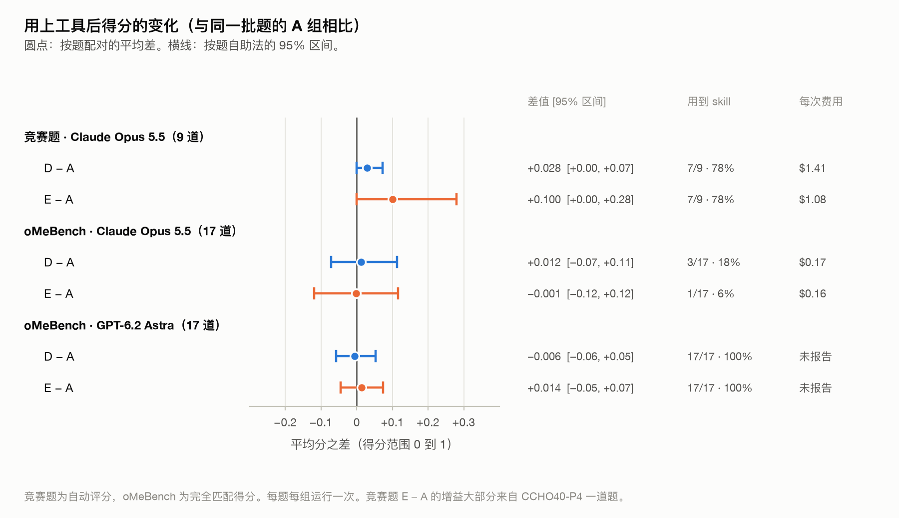

# Codex 有机化学助手

[English](README.md) · **简体中文**

用分子结构核查有机化学答案。你可以比较两个立体异构体、枚举取代产物、核对一串反应机理中间体，也可以沿一条合成路线追踪某个立体中心的构型变化。结构核对无误后，还可以把路线或机理画成期刊风格的图。这些工具都基于本地 RDKit，可以直接使用命令行或 Python，也可以通过 MCP（模型上下文协议）在 Codex 或 Claude Code 中调用。

[快速开始](#快速开始) · [工具选择](#工具选择) · [路线示例](#路线示例) · [画路线图和机理图](#画路线图和机理图) · [基准测试](#基准测试) · [详细文档](#详细文档)


## 快速开始

用 Codex 或 Claude Code 打开本仓库，告诉它「**按照 INSTALL.md 安装项目并运行自检**」即可。手动安装需要先准备好 [uv](https://docs.astral.sh/uv/)，然后在仓库根目录运行以下命令。项目需要 Python 3.12 及以上版本，依赖版本由 `uv.lock` 锁定。

```bash
uv sync --locked --extra mcp
uv run python scripts/check_install.py
```

自检通过时，最后一行是 `install OK`。接下来可以用 2-丁醇的两种构型试一下结构比较。

```bash
uv run codex-chem compare --a 'C[C@H](O)CC' --b 'C[C@@H](O)CC'
```

输出的 JSON 中会出现 `"relation": "enantiomers"`，即两者互为对映体。它们的分子式都是 C₄H₁₀O，唯一的立体中心构型相反。

**接入 AI 助手。** Claude Code 会发现项目自带的 skill，并从 `.mcp.json` 读取服务器配置，按提示批准连接即可。Codex 的 skill 位于 `.agents/skills/`，还需在 `~/.codex/config.toml` 中添加 MCP 服务器配置，并填入本仓库的绝对路径。服务器默认注册 28 个工具并暴露 `chem://skill/...` 资源；非绘图工具默认省去体积较大的 SVG 和 Molblock 字段（需要时可传 `include_drawings=true`），小上下文客户端也可通过 `CODEX_CHEM_MCP_COMPACT=1` 启用 14 工具精简模式。[连接步骤与配置示例](INSTALL.md#4-connect-the-mcp-server-and-the-skill)

## 工具选择

`organic-chemistry-assistant` skill 指导模型根据待核查的结论选择工具。你也可以直接运行命令，或在 Python 中导入 `codex_organic_chem.kit`。

| 想回答的问题 | 命令 | 结果里看什么 |
|---|---|---|
| 两个结构是什么关系？ | `compare` | 是否为同一化合物、对映体、非对映体、互变异构体、同位素异构体或构造异构体，以及哪些四面体、E/Z 或丙二烯轴手性（`Ra`/`Sa`）中心不同。 |
| 有多少种可能？ | `enumerate` | 立体异构体数、取代产物数，或基于三维分子对称性区分的 ¹³C、¹H 环境数（含前手性非对映异位基团），可用于分析 NMR 谱。 |
| 路线或机理中间体序列与反应条件是否自洽？ | `route-check`、`mechanism-steps-check` | 路线各步分子式与电荷变化、立体中心构型与立体专一性烯烃加成、旁观官能团相容性；或针对机理中间体列表，核查价态、自由基奇偶性、质子转移骨架不变性与串联反应闭合。 |
| 哪一面的位阻更大？两个原子能靠多近？ | `model-kit` | 基于 IUPAC 2013 规则的 Re/Si 反应面遮挡与阻挡原子、反应原子间距、二面角构象分布、环上顺反关系、三维可嵌入性及异构体相对能量。 |
| 这张图里画的是什么结构？ | `crop-image`、`parse-image`、`parse-scheme` | 归一化 `0.1` 步长坐标网格标尺与 2× 放大局部裁剪，保留立体构型的常见缩写展开，配合多引擎 OCSR 候选识别及审核台并排校正。 |
| 怎样画路线图或机理图？ | `route-figure`、`mechanism-validate`、`mechanism-render` | 多步路线图全图键长统一，导出 SVG 和 PNG；弯箭头机理图导出 SVG、CDXML 和 ChemDoodle JSON。验证器检查氢和电荷守恒，并逐步重放定域键、分子间 π 键及芳环参与的电子转移。[画路线图和机理图](#画路线图和机理图) |

安装可选引擎后，还可以用 GFN2-xTB 计算能量和 Fukui 指数（含硼、硅体系在 MMFF94 缺参数时自动回退到 UFF）、用 CREST 搜索构象、用 Open Babel 转换文件格式，或从图片识别结构。`uv run codex-chem doctor` 会列出本机可用的引擎。查文献可用 `literature-search`，它优先查询 OpenAlex，必要时回退到 Crossref，并支持 `CODEX_CHEM_MAILTO`、`OPENALEX_API_KEY`、结果缓存与限流退避重试。[可选工具配置](docs/external-tools.md)

## 路线示例

**`route-check` 核查一条已经画好的合成路线。** 输入是目标结构、用 SMILES 表示的编号化合物，以及每一步的反应物、产物和条件。以仓库自带的八步羟脯氨酸路线为例，它会问三个问题。[示例输入](tests/fixtures/routes/hydroxyproline_double_inversion.json) · [对应的路线图](#画路线图和机理图)

1. **原子数的变化能用这一步的试剂解释吗？** 工具计算产物相对反应物多了或少了哪些原子，再把变化与条件中提到的试剂对照。如果还列出了试剂和副产物的结构，它会把这些物种也计入元素与电荷平衡。
2. **同一个立体中心经历了什么？** 工具在反应物和产物之间建立原子映射，按取代基的空间排列判断构型保持或翻转，并核对 `E`/`Z` 烯烃立体专一性加成（协同环氧化/环丙烷化/氮杂环丙烷化、顺式双羟基化与反式双卤代）。取代基优先级改变也可能让 R/S 标签改变，因此单看字母容易误判。
3. **哪些画法需要解释？** 工具检查给定试剂可能影响哪些画成不变的官能团，最后还会逐个立体中心比较最终产物和目标。在这条路线的第 3 步，两个酯基里只有一个发生转化，工具会请你说明选择性的依据。

在 Codex 或 Claude Code 中，可以把文件路径和问题一起交给助手。

> 帮我核查 `tests/fixtures/routes/hydroxyproline_double_inversion.json`。C4 在哪几步发生了构型翻转？还有哪些选择性问题需要确认？

在命令行中也可以运行同一项核查。

```bash
uv run codex-chem route-check \
  --route tests/fixtures/routes/hydroxyproline_double_inversion.json --issues-only
```

原始路线的 C4 在**第 2 步和第 5 步**各翻转一次。最终产物与目标相同（`final_vs_target.relation` 为 `identical`），整条路线有 0 项 `blocking` 和 3 项 `review`。前者表示能从输入确定的矛盾，例如最终产物与目标构型不同。后者是由原子映射或试剂规则提出的复核问题，例如上面的酯基选择性。判断这一步在实验上能否实现，还需要文献或实验依据。

**如果只画反一个中间体呢？** 下面的命令打开两个练习页面。路线练习只改了化合物 7 的 C4。最终产物仍然匹配目标，逐步核查却多出两条 `review`。第 5 步是预期发生翻转的 S<sub>N</sub>2 取代，产物却画成构型保持。到了第 6 步，连在 C4 上的原子没有更换，构型却翻转了。在页面上把化合物 7 的 C4 翻回去并应用修改，这两条提示就会消失。

```bash
uv run codex-chem review-demo --lang zh
```

<details>
<summary>查看化合物 2 的原图与校正后的结构</summary>



</details>

审核页面支持翻转立体中心、指定 R/S 和 E/Z、编辑 SMILES 和粘贴 Molfile。修改保存在本机 `~/.codex-chem/reviews/`，助手可以读取校正后的结构继续工作。[审核操作与截图](docs/human-review.md)

**核查机理中间体序列。** 当题目要求给出一串反应中间体 SMILES，而非多步合成路线或二维弯箭头图时，`mechanism-steps-check` 会逐步检查每个中间体的原子价态与自由基奇偶性、质子转移的重原子骨架不变性、相邻物种分子式与电荷差能否由反应物或试剂解释，并确认最后一步闭合到目标产物（若停在目标产物的构造异构体上，会提示串联反应尚未走完）。

```bash
uv run codex-chem mechanism-steps-check \
  --reaction "C=O.[C-]#N>C#N>OCC#N" \
  --steps '["[O-]CC#N", "OCC#N"]'
```

## 画路线图和机理图

**核查过的路线可以直接画成路线图。** `route-figure` 按 JSON 参数文件里列出的结构和反应条件，排出一张多步路线图。下图就是上面例子里的羟脯氨酸路线，用 ACS 预设按[这份参数文件](docs/examples/hydroxyproline-route-figure.json)画成。[SVG 原图](docs/images/example-route-figure.svg)


- **整张图是一个整体。** 不论分子大小，所有结构的键长、线宽和字号都相同。预设 `acs`、`rsc` 按 ACS、RSC 期刊的风格设定这些比例，`presentation` 字更大，适合幻灯片。
- **骨架保持原位。** 用 SMILES 给出的结构，会把它和前面结构共有的部分固定在相同坐标上再排布。上图中，Boc 保护的吡咯烷环在九个结构里朝向始终一致。Molfile 会保留你在编辑器里画好的布局，只做小角度拉正。
- **先解析结构，再作图。** 每个 SMILES 或 Molfile 都由 RDKit 读取，结果里列出每个化合物的规范 SMILES 和 InChIKey，可以据此确认图上画的就是核查过的结构。楔形键和虚楔键来自输入里的立体信息。
- **版面跟着结构走。** 每个格子按结构和说明文字的实际大小留位，箭头按上下文字的长度加宽，`CH2Cl2` 这类分子式里的数字自动变成下标，而 `XPhos-Pd-G3` 这类预催化剂代号保持原样。结构下方是一行加粗的标签（通常是化合物编号）和可选的灰色名称（支持中英文混排自动换行），每一行还可加 `note` 标注汇聚支路。设置 `max_width` 后，太长的一行会在箭头处断开，分成宽度相近的几行。
- **检查通过才报 `ok`。** 每次作图都会检查元素是否重叠、键长是否一致、文字是否会被裁掉。有问题时，状态会变成 `ok_with_warnings` 或 `blocked_for_publication`。
- **以 SVG 为准。** SVG 是可以继续编辑的原图。本机装有 Chrome、Inkscape、ImageMagick 或 rsvg-convert 时，还会另存一张 PNG 预览。

可以把路线描述给助手，也可以直接给它路线文件。

> 把 `tests/fixtures/routes/hydroxyproline_double_inversion.json` 画成 ACS 风格的路线图，每行三步，试剂写在箭头上方，溶剂和温度写在下方。

在命令行里画上面这张图：

```bash
uv run codex-chem route-figure --spec docs/examples/hydroxyproline-route-figure.json \
  --output-dir outputs/route_figure --format svg --format png
```

<details>
<summary>参数文件的写法</summary>

```json
{
  "style_preset": "acs",
  "rows": [
    {
      "items": [
        {"label": "1", "code": "hydroxyproline ester", "smiles": "COC(=O)[C@@H]1C[C@@H](O)CN1"},
        {"type": "arrow", "label": "Boc2O, Et3N", "sublabel": "CH2Cl2, rt"},
        {"label": "2", "code": "N-Boc", "smiles": "COC(=O)[C@@H]1C[C@@H](O)CN1C(=O)OC(C)(C)C"}
      ]
    }
  ],
  "footnotes": ["Ar = 4-nitrophenyl."]
}
```

各行从上到下、每行从左到右排列。`label` 是结构下方加粗的一行，`code` 是它下面灰色的一行。一行里还可以放 `plus`（加号）和简短的 `text`。加上 `"max_width": 1100`，太长的行会在箭头处自动断开。骨架对齐和下标默认开启，可以用 `"align_structures": false` 和 `"subscript_formulas": false` 关闭。运行 `uv run codex-chem route-figure --example` 可以打印一份完整的参数文件。

</details>

给 `route-check` 加上 `--figure-dir DIR`，它会在核查的同时把整条路线画出来，不用另写参数文件。图中化合物编号加粗、名称写在下方，试剂写在箭头上方、溶剂和温度写在下方，各步分成宽度相近的几行。想自己决定分行和说明文字时，再写参数文件。

**机理图。** `mechanism-render` 根据带原子映射的参数文件画弯箭头机理，每个箭头都从孤对电子或化学键出发，指向原子或化学键，支持分子间 π 键进攻以及凯库勒式活性芳环或旁观芳环。作图之前，`mechanism-validate` 会逐步重放电子转移，并检查氢、电荷与旁观抗衡离子是否守恒。除了 SVG（可选开启教学模式的孤对电子与部分电荷标注），还会输出符合规范的 ChemDraw CDXML、ChemDoodle JSON 和逐步记录。[机理图与路线图详细说明](docs/figures.md)


## 基准测试

题目给出一取代产物的数目时，助手可以枚举每个候选骨架的取代产物，排除与题设不符的结构。写完合成路线后，它可以沿途追踪立体中心，找到需要重画的中间体。我们为这些任务编写了结构核查工具，并在 skill 中说明何时调用、如何依据结果修正答案。

### 模型多常用到 skill？

我们改写了 skill 描述，明确将竞赛题、试卷图片和模型自认为熟悉的结构题纳入适用范围，并让 MCP 服务器在连接时提示模型先加载 skill。预期作用是让模型在给出答案前就有机会选对检查方法，例如用 `enumerate` 去数异构体。

这在一些题型上有效，在另一些题型上还没有。在竞赛真题的触发测试中（图 a），Claude Opus 5.5 在旧描述下有 3/18 次把加载 skill 作为**第一个动作**，换成新描述并加上服务器提示后为 16/18 次。只换描述的一组为 9/9 次，服务器提示的额外贡献仍不确定。在措辞相近、但不属于 skill 范围的问题上，它有 0/24 次首先加载 skill。在提供工具的正式测评中（图 b），竞赛题上**答题期间用到 skill** 的比例从 3/18 升到 14/18。但在 [oMeBench](#在公开基准上这些检查有帮助吗) 的机理题上，同样的配置只有 **4/34** 次用到 skill，而 Codex 中的 GPT-6.2 Astra 34 次全都读取了。这类提示词设定了角色、要求严格的 JSON 输出，还直接给出了产物。也就是说，现在的描述能覆盖竞赛式和开放式的问题，还覆盖不到格式固定的基准提示词。

<picture>
  <source media="(prefers-color-scheme: dark)" srcset="docs/images/skill-loading.zh.dark.png">
  
</picture>

### 路线里改错一处，工具能给出线索吗？

把一根楔形键画反，分子式和电荷都可以保持不变，画出来的也仍是一个合法结构。逐步比对原子和构型后，工具可以指出哪一步出现了不合预期的翻转或保持，模型就有了具体的中间体可以回头检查。

测试从三条八步参考路线生成 **282 个变体**，每次只改一处，例如翻转一个立体中心、移动一个取代基，或省去最后一步。每个变体都与它自己的原始路线比较。原有工具逐个规范化结构，再用每步的反应物和主产物做配平。在这种简写下，原始路线的 24 步全部被标为未配平。[测试脚本](scripts/benchmark_route_check.py)

| 改动 | 原有工具的规范化警告或配平状态发生变化 | `route-check` 出现新的 `blocking` 或 `review` 提示 |
|---|---:|---:|
| 全部变体 | 67/282 | **282/282** |
| 翻转一个立体中心 | 0/36 | 36/36 |
| 将取代基移至相邻碳原子 | 16/27 | 27/27 |

在 282 个出现新提示的变体中，有 **83 个**新增了 `blocking` 问题（包括 `E`/`Z` 烯烃协同环氧化立体构型不符，以及底物或条件无法解释的烷氧基/醇脱除）。三条原始路线均无 `blocking`，每条仍有 0 至 3 条 `review`。脚本只要看到新提示就计数。要知道提示是否指向真正的错误、模型读后能否修对，还需要给诊断和修改后的路线分别评分。

```bash
uv run python scripts/benchmark_route_check.py --output-dir outputs/route_check_benchmark
```

<details>
<summary>各类改动的检出比例（带 95% 区间）</summary>

<picture>
  <source media="(prefers-color-scheme: dark)" srcset="docs/images/route-audit.zh.dark.png">
  
</picture>

</details>

### 这些检查能帮助模型答对整道题吗？

内部 OrgReason-Real 评测让 Claude Opus 5.5（xhigh）读取九道 IChO 和 CChO 有机题的试卷图片，按小题字段自动评分。D 组可以调用预设检查。E 组还可以写 Python，用 RDKit 为当前题目构造专门的检验。每题在每种条件下各运行一次。A 组运行于 2026 年 11 月 17 日，D、E 组运行于次日。

| 条件 | 自动评分均值 | 使用 skill 的题数 | 每题平均费用 |
|---|---:|---:|---:|
| A · 无工具 | 0.878 | — | 0.96 美元 |
| D · MCP 工具和 skill | 0.906 | 7/9 | 1.41 美元 |
| E · D 加上可选的 Python 工具 | 0.978 | 7/9 | 1.08 美元 |

<picture>
  <source media="(prefers-color-scheme: dark)" srcset="docs/images/orgreason-real.zh.dark.png">
  
</picture>

一个具体例子是多环烃题 CCHO40-P4。E 组用 Python 裁出题图中的结构，按图建立分子图，并用 RDKit 枚举、去除重复结构。这道题在 A、D、E 三组分别得 0.20、0.40、1.00，贡献了 E 相对 D 的大部分分差。它展示了模型怎样把一道题里的空间结构和计数问题变成可执行的检查。

九题中有五题在三种条件下都是满分。A 组更早一次运行的均分为 0.923，评分所用的人工转写答案也仍待化学专家复核。要估计稳定的答题增益，以及 `route-check` 等单项工具各自的贡献，还需要重复运行并单独开关相应工具。竞赛题评测框架、题目和运行记录仅供内部使用，CChO 题目版权归中国化学会所有。

### 在公开基准上，这些检查有帮助吗？

[oMeBench](https://arxiv.org/abs/2510.07731) 要求把反应机理写成一串中间体，再与参考机理逐步比对打分（S<sub>total</sub>，0 到 1）。比较各组之前，我们先用与任何模型答案无关的规则核查参考机理：每一步原子守恒，最后一个中间体就是给定产物，价态和自由基合理。196 个参考机理中有 51 个不合格，其中 hard 题 6/23 不合格。两个模型都在通过核查的 17 道 hard 题上作答，每题每组一次，分别运行于 2026 年 11 月 21 日和 22 日。

| 模型 | 条件 | S<sub>total</sub> 均值 | 加载了 skill 的次数 | 每题平均费用 |
|---|---|---:|---:|---:|
| Claude Opus 5.5（xhigh） | A · 无工具 | 0.498 | — | 0.11 美元 |
| | D · MCP 工具和 skill | 0.510 | 3/17 | 0.17 美元 |
| | E · D 加上可选的 Python 工具 | 0.496 | 1/17 | 0.16 美元 |
| Codex 中的 GPT-6.2 Astra（xhigh） | A · 无工具 | 0.419 | — | 未报告 |
| | D · MCP 工具和 skill | 0.412 | 17/17 | 未报告 |
| | E · D 加上可选的 Python 工具 | 0.433 | 17/17 | 未报告 |

<picture>
  <source media="(prefers-color-scheme: dark)" srcset="docs/images/omebench.zh.dark.png">
  
</picture>

两个模型用了工具都没有可测出的提分。D 组减 A 组，Opus 是 +0.01（95% 自助法区间 −0.07 至 +0.11），Astra 是 −0.01（−0.06 至 +0.05）。两个模型加载 skill 的频率差别很大。面对这种格式固定的提示，Opus 通常直接作答。在加载了 skill 的 4 次运行里，它比较了结构、分析了反应或运行了 Python，但一次也没有调用 `mechanism-validate`。可能的原因是 skill 把机理验证放在弯箭头机理图下面介绍，而 oMeBench 要的是中间体列表。Astra 在提供工具的每次运行中都读取了 skill，仍然没有提分。单次运行的波动也不小：Opus 在同样 17 道题上跑了两次 A 组，平均分分别是 0.511 和 0.498，但单题得分平均变化 0.107。要测出小于约 0.1 的效果，需要重复运行。（针对中间体 SMILES 序列的 `mechanism-steps-check` 及相应 skill 指引是在上述 11 月 21—22 日实验之后补充的，无需弯箭头坐标即可逐步核查中间体列表；它在 oMeBench 上的实际效果仍有待多轮重复评测。）

下图把两个基准放在同一个尺度上：同一批题从 A 组到 D 组、从 A 组到 E 组的变化。在 oMeBench 上，四个区间都跨过零。在竞赛题上，两个区间都从零开始：9 道题里，D 组有 7 道、E 组有 6 道与 A 组同分，平均分的提高只来自两三道题，主要是 CCHO40-P4。

<picture>
  <source media="(prefers-color-scheme: dark)" srcset="docs/images/tool-effect.zh.dark.png">
  
</picture>

**太容易的基准。** 在一个基准上跑全部条件之前，我们先看模型不带工具能否答对。下面三个候选都接近满分，因此看不出工具的作用。每次探测都按运行前定好的规则、用固定种子抽 20 题：SUPERChem 取题面或选项里含有机结构的题，ChemIQ 的二维 NMR 题按分子大小分成十档，每档抽两题。

| 基准（各 20 题） | Claude Opus 5.5，无工具 | GPT-6.2 Astra，无工具 |
|---|---:|---:|
| [SUPERChem](https://arxiv.org/abs/2512.01274) 有机单选题，结构以 SMILES 给出 | 19/20 | 17/20 |
| 同一批 SUPERChem 题，结构以图片给出 | 17/20 | — |
| [ChemIQ](https://github.com/oxpig/ChemIQ) 根据分子式和 ¹H、¹³C、COSY、HSQC、HMBC 数据推结构 | 19/20 | — |

图片版答错的 3 题中，有 1 题是还没作答就被 API 的安全过滤拦下了。在二维 NMR 题上，ChemIQ 作者测试过的最好模型只有 20%。这三个基准都在这些模型的训练截止日期之前公开，所以无法判断高分里有多少来自模型见过这些题。这些基准上没有运行 skill 和工具条件。和竞赛题一样，评测框架和运行记录仅供内部使用，基准本身是公开的。

## 详细文档

以下文档为英文。

- [安装与故障排查](INSTALL.md)涵盖运行环境、客户端配置和安装自检。
- [核查工具指南](docs/verification-kit.md)介绍结构比较、异构体枚举、路线核查、机理中间体序列核查、构象分析和逐步逆合成建议。[Python API 参考](.agents/skills/organic-chemistry-assistant/references/kit-api.md)列出参数和返回值。
- [Skill 与 MCP 工具清单](docs/skills-and-mcp.md)介绍可用工具、可选 Python 工具以及 Claude Code 的路线复核子代理。
- [机理图与路线图](docs/figures.md)包含作图示例、SVG 和 CDXML 导出说明，以及化学绘图编辑器的集成方式。
- [依赖说明](DEPENDENCIES.md)和[更新记录](CHANGELOG.md)列出软件要求和各版本的变化。

## 许可证

项目采用 [MIT 许可证](LICENSE)。随仓库分发的 ChemDoodle Web Components 采用 GPLv3 或 iChemLabs 单独授予的商业许可。[第三方许可说明](THIRD_PARTY_NOTICES.md)
