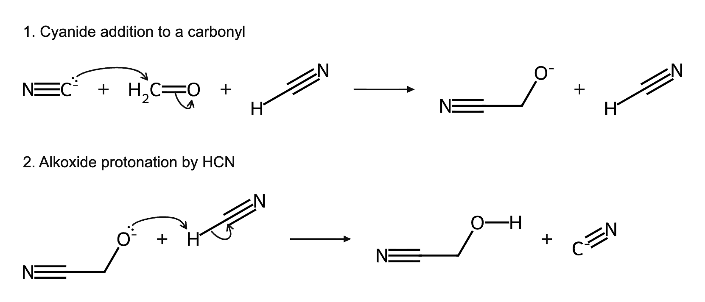
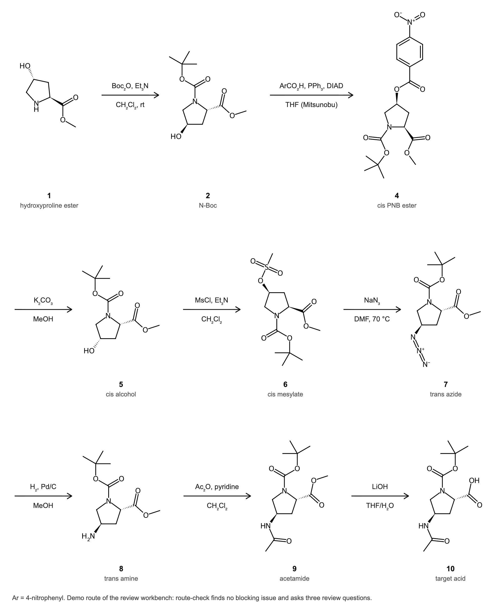

# Mechanism and route figures

[Back to README](../README.md)

Two examples drawn by the toolchain. The mechanism is one of the curated cases
of `scripts/benchmark_mechanisms.py` (cyanohydrin formation, two elementary
steps, electron bookkeeping validated). The route is the demo route of the
review workbench rendered with `route-figure`; `route-check` finds no blocking
issue in it and asks three review questions (which ester K₂CO₃/MeOH cleaves,
the methyl ester under methoxide, the α-centre under LiOH).





## Mechanism Figures

Publication-oriented mechanism work now has two levels. `mechanism-draft` gives
a mechanistic hypothesis and explanation, but it is not treated as final
manuscript artwork:

```bash
codex-chem mechanism-draft \
  --reaction "CBr.[OH-]>>CO.[Br-]" \
  --quality publication
```

This returns `awaiting_user_confirmation` with a reaction preview. After the
rendered reaction is confirmed:

```bash
codex-chem mechanism-draft \
  --reaction "CBr.[OH-]>>CO.[Br-]" \
  --quality publication \
  --confirmed
```

For accurate figure output, use an explicit atom-mapped mechanism canvas:

```bash
codex-chem mechanism-render --example
codex-chem mechanism-validate --spec mechanism.spec.json
codex-chem mechanism-render --spec mechanism.spec.json --output-dir mechanism_out
```

The spec must provide every intermediate and every curved arrow anchor using
atom-map numbers or atom-map bond pairs. It supports:

- `spec_version: "2.1"` semantic mechanism specs (legacy 1.0/2.0 accepted),
- intermediate molecules as mapped SMILES/Molfile,
- curved electron-pair and radical arrows,
- lone-pair dots, with publication defaults that show only mechanistically
  relevant electron-source lone pairs unless `lone_pair_display="all"` is set,
- formal charges and custom charge labels,
- partial charges such as `δ+` and `δ-`,
- graph edits for bond formation/breaking, charge changes, proton transfers,
  resonance, radicals, and counterion bookkeeping,
- panel titles, notes, captions, SVG output, and ChemDraw-like CDXML output.

Version 2.1 requires explicit, disjoint starting/product molecule selections
for every elementary step. The validator checks mapped atom/isotope identity,
hydrogen and charge conservation, electron-source capacity, simultaneous arrow
replay and declared graph edits against the actual next state. `semantic_checks`
reports `valid`, `invalid`, `incomplete` or `unsupported`; valid means supported
electron bookkeeping, not kinetic or experimental proof. Currently supported
replay covers localized main-group pair transfers and paired bond homolysis.
General radical and aromatic/metal mechanisms require further analysis.

Transferred H atoms remain explicit and mapped. The trace resolves each side
separately, computes changes from the structures and retains radical/stereo
metadata. SVG embeds the same spec and trace, with a source-spec SHA-256, so AI
can read the chemistry without guessing from pixels. This digest does not
authenticate later manual edits to SVG paths. The canvas blocks stereo/E-Z and
isotope depictions it cannot faithfully draw. Editor exports remain review
adapters; native-editor round-trip fidelity is not established by these tests.

See the [mechanism authoring contract](../.agents/skills/organic-chemistry-assistant/references/mechanism-spec.md).
For figure quality, use the [published-reference and visual-review workflow](../.agents/skills/organic-chemistry-assistant/references/mechanism-graphics.md).
The default compact renderer now uses the shared RDKit skeletal painter,
sizes rows to their ink, relocates small reagents near reactive atoms and keeps
unchanged mapped cores aligned. Electron arrows use independent cubic end
tangents; sampled collisions with structures/operators/other arrows and arrows
longer than 3.5 bond lengths block the figure. This is a layout heuristic, not a
journal standard or a substitute for viewing the image. The 2× PNG is a review
preview; the SVG is the vector master. `layout.renderer: "legacy"` retains the
old canvas for compatibility. Legacy cell dimensions no longer stretch compact
figures; use molecule `depiction` and arrow `routing` fields for art direction.
Run `uv run python scripts/benchmark_mechanisms.py --output-dir outputs/mechanisms`
for five curated classes, SVG/JSON round trips and deliberately invalid cases.
This is a toolchain regression benchmark, not a model-versus-model accuracy study.

When `--output-dir` is used, the result includes `editor_followup` with local
ChemDraw/ChemDoodle/Marvin/Inkscape/Illustrator open-command templates for the
generated files when those tools are detected.

`mechanism-render` now returns and writes a multi-format publication/review
package:

- `mechanism.svg`: RDKit-based vector layout with atom-map anchored electron
  arrows, shortened endpoints, restrained journal-style arrow weights, optional
  source-only lone-pair display, and cross-panel alignment.
- `mechanism.cdxml`: ChemDraw-like CDXML containing fragments, nodes, bonds,
  text, reaction-step records, and electron-flow arrow objects.
- `mechanism.chemdoodle.json`: ChemDoodle JSON with `Pusher` shapes whose
  source/target ids point to atom or bond objects and preserve electron count;
  atoms also carry lone-pair counts such as `numLonePair`.
- `mechanism.chemdoodle.html`: a local ChemDoodle Web Components viewer when
  `integrations/chemdoodle/ChemDoodleWeb.js` is installed.
- `mechanism.trace.json`: an AI-readable step trace with starting state,
  electron moves, graph edits, bond/charge changes, expected state, validation
  checks, and review boundaries.
- `mechanism.ketcher.json`: an adapter payload for using Ketcher as the
  open-source correction gate for structures, reactions, and atom maps.
- `mechanism.marvin.json`: an adapter payload for ChemAxon Marvin/Marvin JS
  review when a licensed Marvin package is installed locally.

`mechanism-render` also runs a publication-figure gate. If an arrow has no
electron source/sink, starts from an atom center instead of a lone pair or bond,
references missing atom-map numbers, or depends on a hidden lone pair, the result
is marked `blocked_for_publication` or `ok_with_warnings` and includes
`publication_checks`.

This mirrors how manuscript mechanisms are usually made: ChemDraw/CDXML or
similar chemical drawing software for the chemical canvas, with final manual
polishing in ChemDraw, ChemDoodle, Marvin, ChemSketch, Illustrator, or Inkscape.
ChemDraw/CDXML, ChemDoodle, and Marvin-style tools support reaction/mechanism
arrows and chemical annotations in ways RDKit alone does not. The generated
`mechanism_trace` is intended to help an AI reason step by step through the
public, auditable mechanism state rather than guessing from a single overall
reaction equation.

Implementation rule learned from ChemDoodle/Marvin-style editors: electron
pushers must be attached to chemical objects, not arbitrary SVG curves.
Therefore `mechanism-render` treats `from_lone_pair_atom_map`, `from_bond`,
`to_atom_map`, and `to_bond` as chemical anchors. It warns when disconnected
reactants are packed into one molecule entry, because that gives poor RDKit
layout and unreadable arrow geometry; use separate molecule entries for each
reactant, intermediate, counterion, or byproduct.

For manuscript-like figures, keep the visual electron annotations sparse:
`presentation_mode="publication"` defaults to source-only lone-pair display, so
an anionic nucleophile can carry one visible lone-pair pair at the arrow tail
while nonreacting heteroatom lone pairs and product lone pairs stay hidden.
Use full lone-pair counts only for teaching, debugging, or when the chemistry
requires them.

## Route Figures

Route and reaction-scheme figures are a first-class skill capability. Use
`route-figure` when the desired output is the composed publication-style route
figure format rather than a compact RDKit reaction preview.

```bash
codex-chem route-figure --example
codex-chem route-figure --spec route_figure.spec.json --output-dir route_out --format svg --format png
```

The route spec is JSON with a `rows` list. Each row contains ordered `items`:
molecule items with reviewed `smiles` or `molfile`, `arrow` items with a main
label and optional sublabel, and optional `plus` or short `text` items. The
renderer validates and normalizes every molecule through RDKit, composes a
single SVG master from independent molecule fragments, and writes PNG output
from that SVG when a local rasterizer such as Chrome, Inkscape, ImageMagick, or
`rsvg-convert` is available.

This makes the route-figure format reproducible for users who install the
GitHub repository; it is no longer dependent on unrelated local scripts or
one-off prompt reconstruction.

### Optional editor integrations

Ketcher can be built locally from the bundled integration:

```bash
cd integrations/ketcher
npm install
npm run build
npm run preview -- --port 4173
```

`codex-chem figure-tools` auto-detects `integrations/ketcher/dist` after a
local build. The repository commits `package.json` and `package-lock.json`, but
ignores `node_modules/` and `dist/`.
`chem_structure_review_batch` serves that built `dist` directly from its local
review server when present, targets a running Vite/Ketcher URL when
`CODEX_CHEM_KETCHER_URL` is set, and otherwise falls back to the built-in
review editor so human confirmation never requires a build step.

ChemDoodle Web Components are detected from `integrations/chemdoodle` or
`CODEX_CHEM_CHEMDOODLE_WEB_DIR`; the renderer writes
`mechanism.chemdoodle.html` so atom-bound lone pairs and object-bound pusher
arrows can be reviewed in a ChemDoodle-style renderer. The bundled ChemDoodle
Web Components files are third-party GPLv3/commercial-license files; see
[THIRD_PARTY_NOTICES.md](../THIRD_PARTY_NOTICES.md).

Marvin JS/Desktop requires a ChemAxon license. Place a licensed Marvin JS
package in `integrations/marvin` or set `CODEX_CHEM_MARVIN_JS_DIR`; the renderer
still writes `mechanism.marvin.json` and CDXML/MOL/RXN-facing artifacts for
manual Marvin review.
