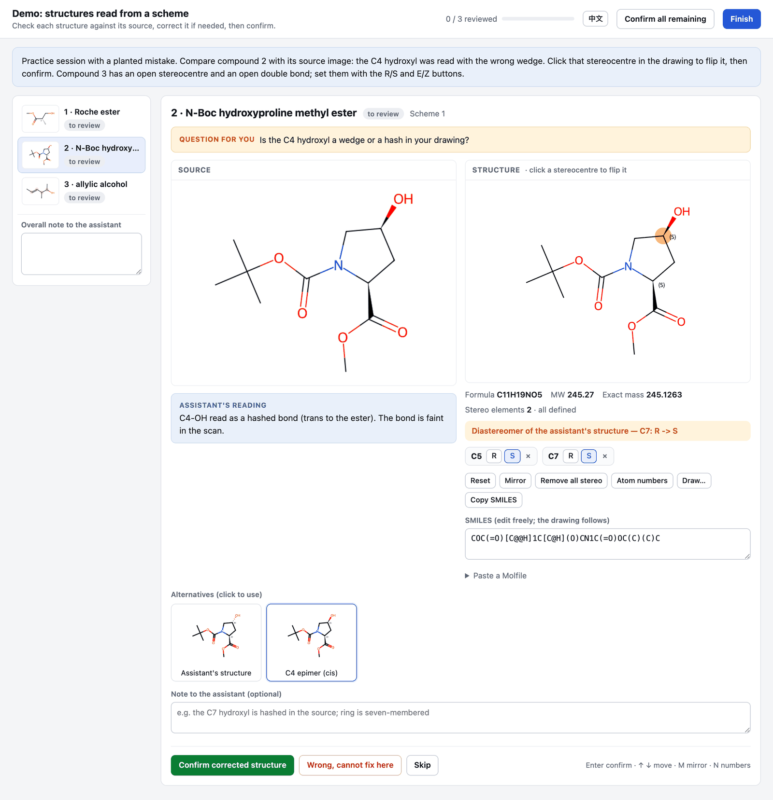
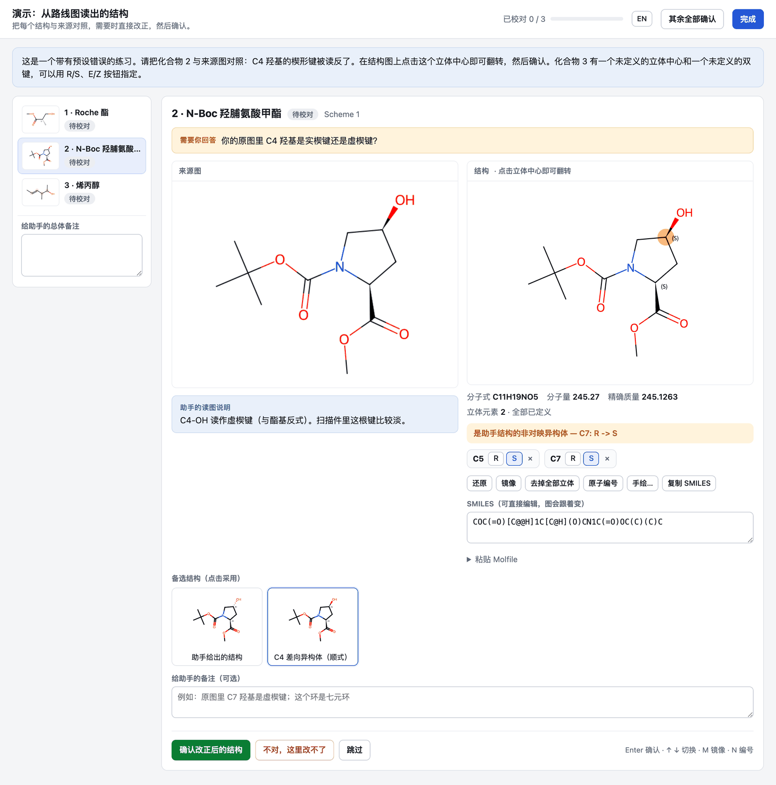
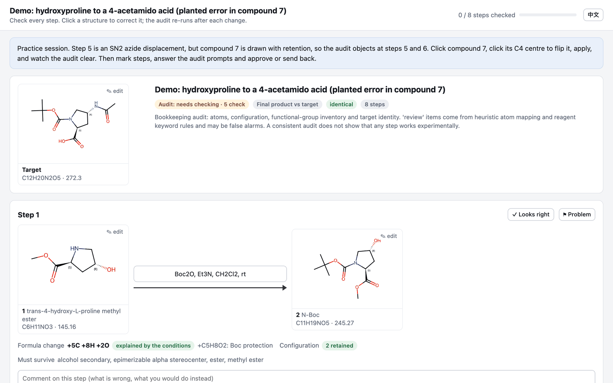
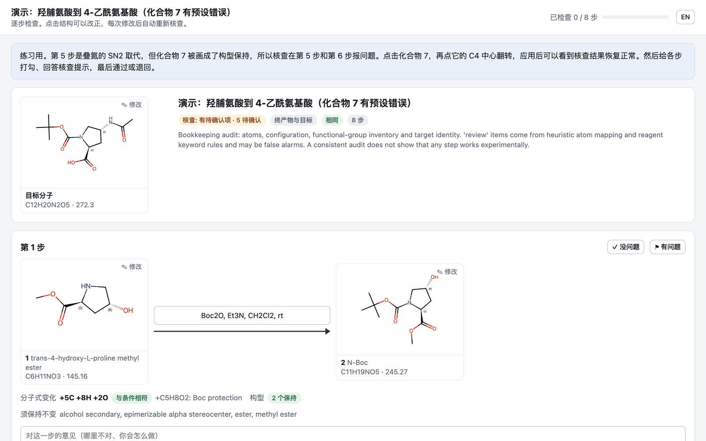
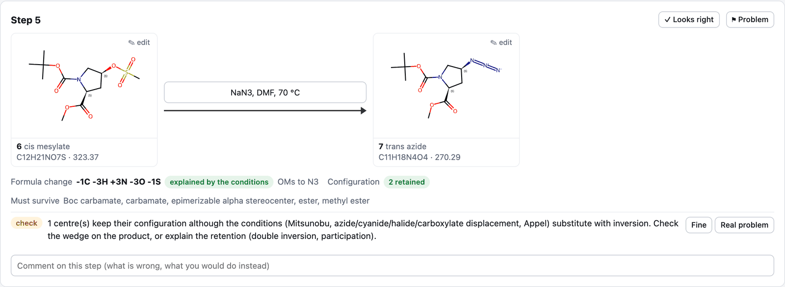
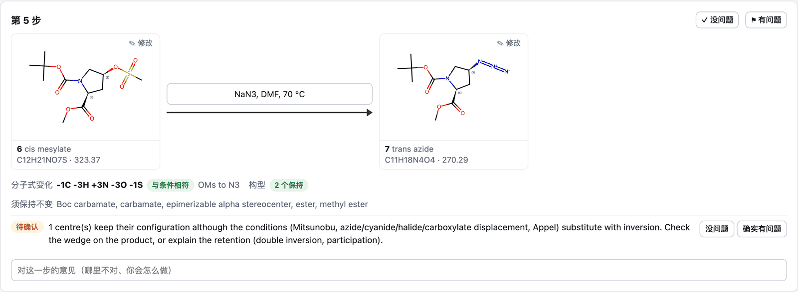
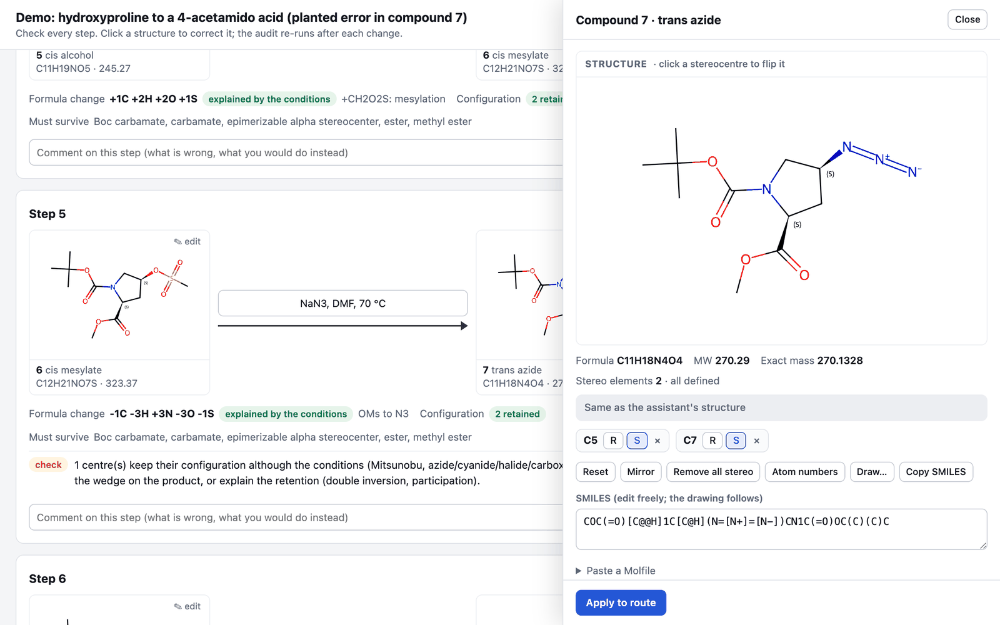
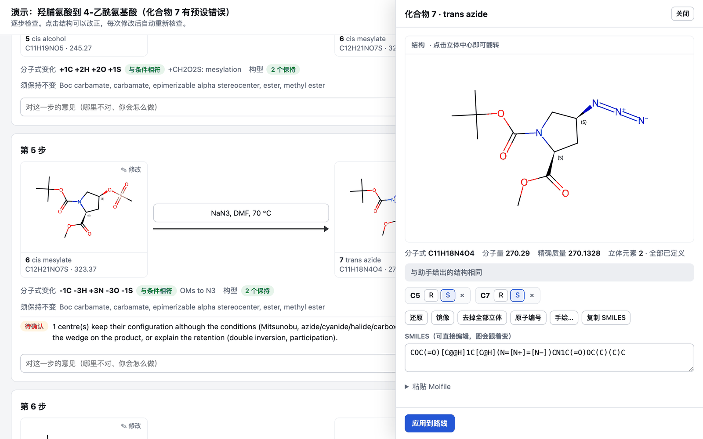

# Review workbench

[Back to README](../README.md)

## Human Review

Checks catch bookkeeping; they cannot know that a wedge in the user's drawing
was a hash, or that a step already failed in their hands. The review page puts
that knowledge into the loop. It opens in the default browser, needs no build
step, and returns the user's corrections as data.

```bash
uv run codex-chem review-demo --lang zh          # two practice sessions with planted mistakes
uv run codex-chem review-batch --input items.json   # structures, each beside the crop it was read from
uv run codex-chem input-review --image-path crop.png --note "C4-OH read as hashed"
uv run codex-chem route-review --route route.json   # a route with the audit laid out per step
uv run codex-chem review-result --session-id <id> --wait
uv run codex-chem review-mode ask                # auto (default) | ask | off
```

The page is bilingual: the button in the top bar switches between English and
Chinese, and `--lang` or `?lang=en|zh` picks the start language. Audit messages
from `route-check` and compound names taken from the route file stay in English.
The screenshots below are the two practice sessions of `codex-chem review-demo`.

| | English | 中文 |
|---|---|---|
| Structures: compound 2 after the reviewer flipped C4 to match the source | [](images/review-structures.en.png) | [](images/review-structures.zh.png) |
| Route: audit summary and the first step | [](images/review-route.en.png) | [](images/review-route.zh.png) |
| Route: step 5, where the planted retention is flagged | [](images/review-route-step.en.png) | [](images/review-route-step.zh.png) |
| Route: the structure editor opened on compound 7 | [](images/review-route-editor.en.png) | [](images/review-route-editor.zh.png) |

**Structures.** Each item shows the assistant's structure with CIP labels next
to its source image, the assistant's one-line reading and question, and any
alternative readings. The reviewer clicks a stereocentre to flip it, sets an
open centre or double bond with R/S and E/Z buttons, picks an alternative,
edits SMILES, pastes a Molfile or draws in Ketcher. The page says at once how
the edit relates to the original (`Diastereomer - C7: R -> S`) and keeps the
drawing still so only the changed wedge moves. Items are confirmed, corrected,
rejected with a note, or skipped.

```json
{"title": "Scheme 2 structures",
 "intro": "Read from your scheme; the wedges on 7 are the ones I am least sure of.",
 "items": [{"id": "7", "label": "7", "smiles": "COC(=O)[C@@H]1C[C@@H](O)CN1C(=O)OC(C)(C)C",
            "image_path": "crops/7.png", "note": "C4-OH read as hashed",
            "question": "Is the C4 hydroxyl a wedge or a hash?",
            "candidates": [{"label": "C4 epimer", "smiles": "COC(=O)[C@@H]1C[C@H](O)CN1C(=O)OC(C)(C)C"}]}]}
```

**Routes.** `route-review` takes the same file as `route-check` and shows every
step as reactants, conditions and product with the formula change, what
happened to each stereocentre (changed centres are highlighted on the product)
and the audit prompts. Clicking a compound opens the same editor; changing a
structure or the conditions of a step re-runs the audit immediately. Each step
can be marked right or wrong with a comment, each audit prompt answered `Fine`
or `Real problem`, and the route approved or sent back. The result carries the
reviewer's version of the route (`route_result.route`), what they changed, and
every decision.

**Lifecycle.** CLI sessions are handed to a small background server (started on
demand, stopped after 15 idle minutes), so the page stays up after the command
returns; `--wait` blocks for the answer instead. Every change is saved to
`~/.codex-chem/reviews/<session>.json`, so `review-result` works from any later
command, and a wait that times out leaves the session open. MCP sessions live
in the MCP server process and are collected with
`chem_structure_review_result`.

**When it opens.** `review-mode` is the user's setting. `auto` opens the page at
every review gate (structures read from an image; a route about to be acted
on), `ask` makes the assistant ask one line in chat first, `off` never opens it
unless the user asks. `CODEX_CHEM_REVIEW` overrides the saved setting, and
`CODEX_CHEM_REVIEW_OPEN_BROWSER=0` keeps the browser from opening while still
returning the URL. Headless benchmark runs set `CODEX_CHEM_REVIEW=off`.

Confirmed and corrected structures are re-normalized through RDKit before
downstream reasoning sees canonical/isomeric SMILES, Molfile, InChIKey,
warnings and metadata. Publication mechanisms, expensive calculations and
literature-backed route expansion built on image-derived structures should
start only after that result is in.
